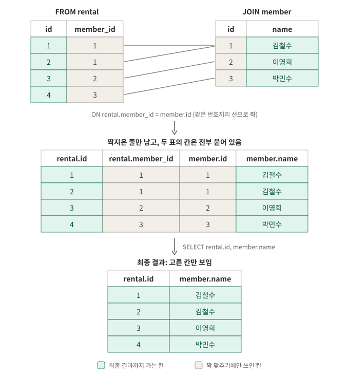
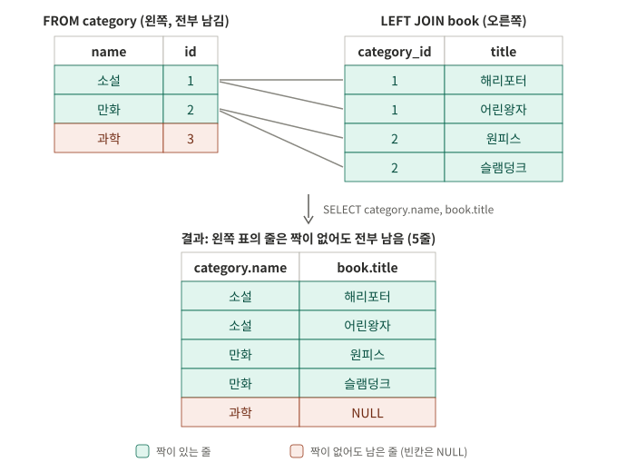
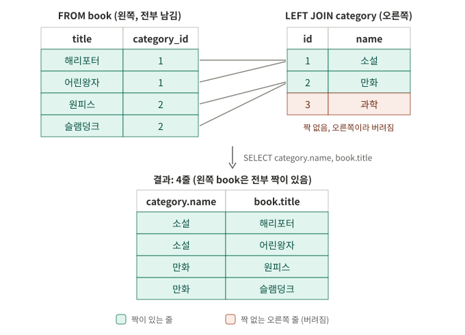

# B6-1 · 정보를 깔끔하게 정리하는 디지털 서랍장 만들기

| 분야 | 구분 | 학습시간 | 필수/선택 |
|---|---|---|---|
| AI/SW 기초 | 데이터베이스와 백엔드 | 40시간 | 필수 |

**주제: 도서 대여 / DB: SQLite / 범위: 필수 요구사항만 (보너스 제외)**

과제 순서대로 개념을 하나씩 공부하면서, 공부한 내용을 **과제 목표 6개** 기준으로 이 README에 정리합니다.
각 개념은 "원본 표 → 짝 맞추기 → 결과 표"처럼 **실제 데이터로 따라가는 방식**으로 적었습니다.
직접 풀어 본 확인 문제와 헷갈렸던 질문은 [docs/practice.md](docs/practice.md)에 있습니다.

## 진행 상황

| 단계 | 내용 | 과제 목표 | 상태 |
|---|---|---|---|
| 0 | DB와 엑셀의 차이 | 1 | ✅ |
| 1 | DB 환경 준비 (SQLite) | - | ✅ |
| 2 | 스키마 설계 (PK, FK, 1:N) | 2 | ✅ |
| 3 | 제약조건 (NOT NULL, UNIQUE, FK) | 2 | ✅ |
| 4 | 샘플 데이터 (INSERT) | 3 | ✅ |
| 5-1 | 기본 조회 (WHERE, ORDER BY, LIMIT) | 3, 5 | ✅ |
| 5-2 | JOIN (INNER, LEFT) | 4 | ✅ |
| 5-3 | 집계 (COUNT, SUM, AVG + GROUP BY) | 4, 5 | ⬜ |
| 5-4 | 서브쿼리 | 5 | ⬜ |
| 5-5 | UPDATE / DELETE | 3 | ⬜ |
| 5-6 | 인덱스 | 6 | ⬜ |

## 제출물

| 과제 요구 | 파일 | 상태 |
|---|---|---|
| 스키마 생성 SQL 1개 | [sql/01_schema.sql](sql/01_schema.sql) | 작성 예정 |
| 샘플 데이터 INSERT SQL 1개 | [sql/02_data.sql](sql/02_data.sql) | 작성 예정 |
| 쿼리 15개 SQL 1개 | [sql/03_queries.sql](sql/03_queries.sql) | 작성 예정 |
| 실행 결과 폴더 1개 | [results/](results/) | 작성 예정 |

```text
codyssey_B6-1/
├── README.md            과제 목표 6개 기준 학습 정리
├── sql/
│   ├── 01_schema.sql    CREATE TABLE (부모 → 자식 순서)
│   ├── 02_data.sql      INSERT (부모 → 자식 순서)
│   └── 03_queries.sql   핵심 쿼리 15개
├── results/             쿼리 실행 결과
└── docs/
    ├── practice.md      확인 문제, 내 답, 헷갈렸던 질문
    └── images/          README 그림
```

## 실행 방법

macOS에는 SQLite가 기본으로 설치되어 있습니다. `sqlite3 --version`으로 확인합니다.

```bash
sqlite3 library.db
```

`sqlite>` 표시가 나오면 DB 안에 들어온 상태입니다. 아래를 순서대로 실행합니다.

```sql
PRAGMA foreign_keys = ON;   -- SQLite 전용. 접속할 때마다 켜야 FK 검사가 동작함
.mode table                 -- 결과를 표 모양으로 (점으로 시작하는 건 SQLite 프로그램 명령)
.headers on
.read sql/01_schema.sql
.read sql/02_data.sql
.read sql/03_queries.sql
.quit
```

`library.db`는 SQL 파일만 있으면 언제든 다시 만들 수 있어서 레포에 올리지 않습니다 (`.gitignore`).

## 테이블 설계

학습하면서 정한 구조입니다. 최종 컬럼은 [sql/01_schema.sql](sql/01_schema.sql)을 기준으로 합니다.

```text
category (1) ──< book   (N)     카테고리 1개에 책 여러 권
book     (1) ──< rental (N)     책 1권은 여러 번 대여될 수 있음
member   (1) ──< rental (N)     회원 1명은 여러 번 대여할 수 있음
```

`(1)`은 하나, `(N)`은 여러 개, `<`가 붙은 쪽이 **여러 개 쪽**이고 **FK를 가진 테이블**입니다.

| 테이블 | 주요 컬럼 | 역할 |
|---|---|---|
| category | id (PK), name | 책 분류 |
| member | id (PK), name, email, phone | 회원 정보 |
| book | id (PK), title, category_id (FK) | 책 정보 |
| rental | id (PK), member_id (FK), book_id (FK), rented_at, returned_at | 누가 어떤 책을 언제 빌렸나 |

- 테이블 4개, 1:N 관계 3개로 과제 조건(4개 이상, 2개 이상)을 만족합니다.
- 만드는 순서와 데이터를 넣는 순서는 모두 **category → member → book → rental** (부모 먼저)입니다.

---

## 과제 목표 정리

### 1. DB는 엑셀과 뭐가 다른가, 왜 테이블로 나눠 저장하나

엑셀 한 시트에 대여 기록을 모두 적으면 이렇게 됩니다.

| 회원이름 | 전화번호 | 책제목 | 대여일 |
|---|---|---|---|
| 김철수 | 010-1111 | 해리포터 | 10/01 |
| 김철수 | 010-1111 | 어린왕자 | 10/05 |
| 이영희 | 010-2222 | 해리포터 | 10/07 |

- **중복**: 김철수의 정보가 대여할 때마다 반복됩니다.
- **수정 문제**: 번호가 바뀌면 모든 줄을 고쳐야 하고, 하나라도 빠뜨리면 데이터가 서로 안 맞습니다.
- **잘못된 입력**: 없는 회원이나 오타를 적어도 막지 않습니다.

DB는 **주제별로 테이블을 나누고, 번호로 연결**합니다. 회원 정보는 member에 한 번만 있고, rental은 이름 대신 `member_id`(번호)만 갖습니다.

| 질문 | 엑셀 | DB |
|---|---|---|
| 각 행을 구분하는 번호 | 행 번호는 **위치**라 정렬하면 바뀜 | PK는 데이터에 붙은 **이름표**라 안 바뀜 |
| 없는 회원 번호 99를 적으면 | 그냥 저장됨 | **FK가 막음** |
| 빈 이름, 중복 이메일 | 그냥 저장됨 | **제약조건이 막음** |

PK는 엑셀에서도 id 열을 만들어 흉내 낼 수 있습니다. 결정적인 차이는 **FK와 제약조건으로 관계와 규칙을 DB가 강제한다**는 점입니다.

> 주의: SQLite는 **타입은 엄격하게 지키지 않습니다.** `INTEGER` 칸에 `'abc'`를 넣어도 대부분 저장됩니다 (`INTEGER PRIMARY KEY` 제외). 반면 NOT NULL, UNIQUE, FK 같은 **제약조건을 어기면 거부**합니다.

### 2. PK / FK / 1:N 관계는 데이터를 어떻게 연결하나

- **PK (기본키)**: 각 행을 구분하는 고유 번호. 비어 있을 수 없고 겹칠 수 없음 (= NOT NULL + UNIQUE).
- **FK (외래키)**: 다른 테이블의 PK를 가리키는 칸. 예: `rental.member_id → member.id`
- **1:N**: 한쪽 1개가 반대쪽 여러 개와 연결되는 관계. **FK는 항상 N(여러 개) 쪽에 둡니다.**

**왜 FK가 N 쪽에 있어야 하나**: book에 `member_id`를 넣으면 책 한 권당 회원 칸이 하나뿐이라, 해리포터를 빌린 김철수와 이영희 중 한 명만 적을 수 있습니다.
그래서 "누가 어떤 책을 언제 빌렸다"는 **사건 자체를 rental에 기록**하고, rental이 `member_id`와 `book_id`를 모두 들고 있습니다.

#### 제약조건: 이런 데이터는 받지 않는다

| 제약 | 의미 | 이 설계에서 |
|---|---|---|
| `NOT NULL` | 빈 값 금지 | 이름 없는 회원은 이상함 → `member.name` |
| `UNIQUE` | 중복 금지 | 이메일로 회원을 구분 → `member.email` |
| `FOREIGN KEY` | 없는 번호 참조 금지 | `rental.member_id`, `rental.book_id`, `book.category_id` |

- 한 컬럼에 여러 개를 같이 걸 수 있습니다: `email TEXT NOT NULL UNIQUE` (UNIQUE만 걸면 빈 값은 막지 않음).
- 판단 기준: **"이 값이 없으면 안 되나?" → NOT NULL**, **"이 값으로 사람을 구분하나?" → UNIQUE**.
- 제약조건은 정답이 정해진 게 아니라 **서비스 규칙을 DB에 옮기는 것**입니다. (예: 가족이 전화번호를 같이 쓸 수 있으면 phone에는 UNIQUE를 걸지 않음)
- **SQLite는 FK 검사가 기본으로 꺼져 있어서** `PRAGMA foreign_keys = ON;`을 먼저 실행해야 없는 값 참조가 막힙니다.

#### 데이터 넣는 순서: 부모 먼저

rental에 `member_id = 1`을 넣으려면 member에 1번 회원이 **이미 있어야** 합니다.

```sql
INSERT INTO rental (id, member_id, book_id, rented_at) VALUES (1, 1, 1, '2026-10-01');
-- member, book이 비어 있으면 → Error: FOREIGN KEY constraint failed
```

- **에러 난 INSERT는 저장되지 않습니다.** 그래서 그 행을 가리키는 뒷줄도 연달아 실패합니다. 에러가 여러 개면 맨 위부터 고칩니다.
- 여러 줄을 한 번에 넣다가 **한 줄만 틀려도 그 INSERT 문 전체가 취소**됩니다.

### 3. SELECT / INSERT / UPDATE / DELETE는 언제 쓰나

| 명령 | 언제 | 정리한 단계 |
|---|---|---|
| `INSERT` | 새 행을 추가할 때 | 4단계 ✅ |
| `SELECT` | 저장된 데이터를 꺼내 볼 때 | 5-1단계 ✅ |
| `UPDATE` | 이미 있는 행의 값을 바꿀 때 | 5-5단계 ⬜ |
| `DELETE` | 행 자체를 지울 때 | 5-5단계 ⬜ |

**INSERT 읽는 법**

```sql
INSERT INTO member (id, name, email, phone)        -- member 표에, 이 순서의 칸으로 넣겠다 (선언)
VALUES (1, '김철수', 'kim@a.com', '010-1111-1111'); -- 선언한 순서대로 값
```

**SELECT 쓰는 순서와 실행 순서는 다릅니다.**

```text
쓰는 순서:  SELECT → FROM → (JOIN … ON) → WHERE → ORDER BY → LIMIT
실행 순서:  FROM → (JOIN … ON) → WHERE → SELECT → ORDER BY → LIMIT
```

DB는 **어느 표에서(FROM) → 붙이고(JOIN) → 걸러내고(WHERE) → 칸을 고르고(SELECT) → 정렬하고 → 자릅니다.**
SQL은 세미콜론(`;`)까지를 **한 문장**으로 끝까지 읽은 뒤 실행하기 때문에, 맨 앞에 쓴 SELECT가 뒤의 JOIN 결과에서 칸을 고를 수 있습니다.

### 4. JOIN과 GROUP BY로 연결된 데이터를 한 번에 뽑는 방법

#### JOIN: 번호가 같은 줄끼리 짝지어 새 표를 만든다

```sql
SELECT rental.id, member.name
FROM rental
JOIN member ON rental.member_id = member.id;
```

| 부분 | 역할 |
|---|---|
| `FROM rental` | rental 표를 꺼낸다 (기준) |
| `JOIN member` | member 표도 꺼내고, rental과 붙이겠다고 선언한다 |
| `ON rental.member_id = member.id` | 이 두 값이 **같은 줄끼리** 붙인다 |
| `SELECT rental.id, member.name` | 붙인 표에서 이 두 칸만 보여준다 |



- **ON은 어떤 줄이 남을지**, **SELECT는 어떤 칸을 보여줄지** 정합니다.
- JOIN은 원본 표를 바꾸지 않습니다. 짝지은 결과를 **새 표에 나란히 옮겨 적을 뿐**입니다.
- 쓰려는 표는 반드시 **FROM이나 JOIN으로 먼저 꺼내야** 합니다. ON에 `member.id`를 써도 `JOIN member`가 없으면 `no such column` 에러입니다.
- 두 표에 같은 이름의 칸(`id`)이 있어서 `테이블.컬럼`으로 **어느 표 출신 칸인지** 적습니다. 그냥 `id`라고 쓰면 `ambiguous column name` 에러입니다.
- ON 안의 `=` 양쪽 순서는 바꿔도 결과가 같습니다.

#### INNER JOIN과 LEFT JOIN

| | INNER JOIN (`JOIN`) | LEFT JOIN |
|---|---|---|
| 짝이 있는 줄 | 남음 | 남음 |
| **왼쪽(FROM) 표**의 짝 없는 줄 | 버림 | **남김** (오른쪽 칸은 NULL) |
| 오른쪽 표의 짝 없는 줄 | 버림 | 버림 |
| 표 순서를 바꾸면 | 결과 같음 | **결과가 달라질 수 있음** |

**LEFT JOIN의 "왼쪽"은 FROM에 쓴 표**입니다. 책이 없는 "과학" 카테고리를 살리려면 category를 FROM에 둡니다.



표 순서를 반대로 하면 과학은 **오른쪽** 표에 있게 되어 버려집니다. 왼쪽인 book은 4권 모두 짝이 있어서 결과는 INNER JOIN과 같은 4줄입니다.



**요구사항 읽는 법**: "~가 **없는 ○○도 포함**"이라는 말이 있으면 LEFT JOIN을 쓰고 ○○을 FROM에 둡니다. SELECT에 적는 칸 순서나 문장의 단어 순서와는 관계없습니다.

```sql
-- 대여 기록이 없는 회원도 포함해서 회원 이름과 대여 번호 보기
SELECT member.name, rental.id
FROM member
LEFT JOIN rental ON rental.member_id = member.id;

-- 대여 기록이 없는 회원만 보기 (짝이 없어 NULL인 줄만 남김)
SELECT member.name
FROM member
LEFT JOIN rental ON rental.member_id = member.id
WHERE rental.id IS NULL;
```

#### GROUP BY

5-3단계에서 정리 예정.

### 5. 검색 / 정렬 / 집계 / 랭킹을 SQL로 어떻게 푸나

아래 예시는 설명을 위해 book에 `price` 컬럼이 있다고 가정했습니다.

| 요구 | SQL | 예 |
|---|---|---|
| 조건 검색 | `WHERE` | `WHERE price >= 10000` |
| 글자 검색 | `WHERE ... LIKE` | `WHERE title LIKE '%포터%'` |
| 빈 값 찾기 | `IS NULL` | `WHERE returned_at IS NULL` (아직 반납 안 함) |
| 정렬 | `ORDER BY ... ASC/DESC` | `ORDER BY price DESC` (큰 것부터) |
| 개수 제한, 랭킹 | `ORDER BY` + `LIMIT` | `ORDER BY price DESC LIMIT 2` (가장 비싼 2권) |
| 집계 | `COUNT`, `SUM`, `AVG` + `GROUP BY` | 5-3단계에서 정리 예정 |

- 빈 값은 `= NULL`로 찾으면 아무것도 안 나옵니다. 반드시 `IS NULL`을 씁니다.
- `ASC`(작은 것부터)는 기본값이라 생략할 수 있지만, 써두면 의도가 바로 보입니다.

```sql
-- 가격이 10000원 미만인 책을 싼 순서대로 2권
SELECT title FROM book WHERE price < 10000 ORDER BY price ASC LIMIT 2;
```

### 6. 인덱스는 왜 필요하고 어디에 거나

5-6단계에서 정리 예정.
