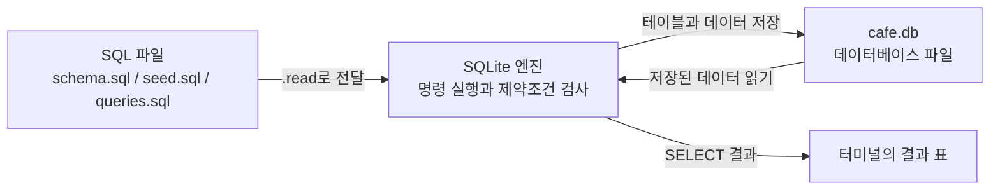
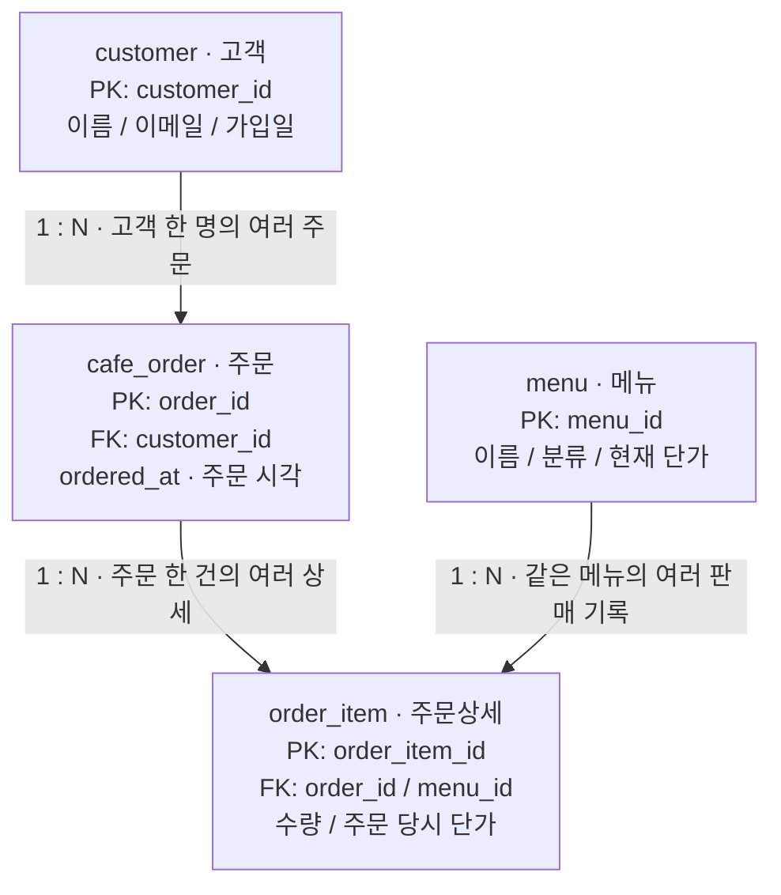
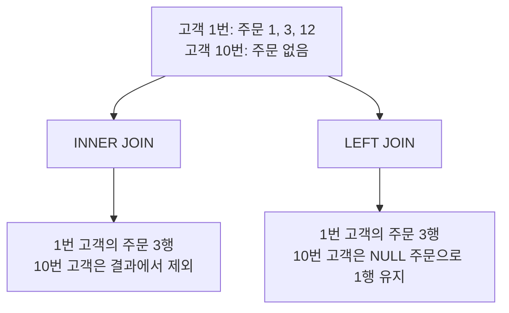

# B6-1 · 정보를 깔끔하게 정리하는 디지털 서랍장 만들기

| 분야 | 구분 | 학습시간 | 필수/선택 |
|---|---|---|---|
| AI/SW 기초 | 데이터베이스와 백엔드 | 40시간 | 필수 |

**구현 주제: 카페 주문 관리 / DB: SQLite / 핵심 구현: SQL 파일 3개**

과제 원문의 순서에 맞춰 **1. 미션 소개 → 2. 최종 결과물 → 3. 과제 목표 → 4. 기능 요구 사항 → 5. 보너스 과제 → 6. 개발 환경 → 7. 제약 사항 → 8. 결과 예시**로 읽습니다.
실행부터 확인하려면 [6. 개발 환경과 실행 방법](#run), 개념을 공부하려면 [1. 기본 개념](#basics)부터 시작합니다.
[설계 이유](#design) · [PK/FK와 제약조건](#keys) · [SQL 명령어 사용법](#commands) · [15개 쿼리](#queries) · [실제 결과와 평가 준비](#verification)

## 1. 미션 소개

카페에서 “누가, 언제, 어떤 메뉴를, 몇 개 주문했는가”를 저장하고 필요한 정보를 SQL로 꺼냅니다.
단순히 표를 네 개 만드는 것이 아니라 **현실의 요구를 테이블과 연결 규칙으로 표현하고, 그 구조에서 답을 찾는 것**이 목표입니다.
웹사이트나 API를 만드는 과제가 아닙니다. 테이블 설계 → 샘플 입력 → 조회·조인·집계 → 수정·삭제·검증 순서로 진행합니다.

<a id="basics"></a>

### DB, DBMS, SQLite, SQL은 서로 다른 말입니다

| 용어 | 쉬운 뜻 | 이 프로젝트에서 해당하는 것 |
|---|---|---|
| 데이터(data) | 저장할 개별 사실 | 김민수의 이름, 아메리카노 가격 4,000원, 주문 수량 2개 |
| 데이터베이스(DB) | 관련된 데이터를 규칙에 맞게 모아 둔 저장소 | 고객·메뉴·주문·주문상세를 담은 `cafe.db` |
| DBMS | DB의 저장·조회·변경과 규칙 검사를 맡는 소프트웨어 | SQLite 엔진 |
| SQL | DBMS에 표 생성·입력·조회·수정 등을 요청하는 언어 | `CREATE TABLE`, `INSERT`, `SELECT` 등 |
| CLI | 명령을 글자로 입력하는 도구 | 터미널에서 실행하는 `sqlite3` 프로그램 |
| 쿼리(query) | DB에 보내는 질의. 이 README에서는 실행할 SQL 문장도 함께 지칭 | “4,500원 이하 메뉴를 보여줘”를 표현한 SELECT |

**SQLite는 실행을 담당하고, SQL은 실행할 명령을 표현합니다.** `schema.sql` 같은 파일은 명령을 적어 둔 텍스트입니다.
파일을 작성하는 것만으로 데이터가 저장되지는 않습니다. SQLite에 실행시켜야 테이블과 데이터가 만들어집니다.
`cafe.db`는 그 실행으로 만들어지는 저장 파일이며 SQL 원문 파일과 구분합니다. [SQLite CLI 공식 문서](https://sqlite.org/cli.html)



도식은 GitHub에서 표시하는 **Mermaid 다이어그램**입니다. 별도 설치가 필요한 실행 기능이 아니며,
도식이 표시되지 않는 편집기에서도 아래 설명과 표만으로 읽을 수 있습니다. [GitHub 다이어그램 안내](https://docs.github.com/en/get-started/writing-on-github/working-with-advanced-formatting/creating-diagrams)

### 테이블, 행, 컬럼, 스키마는 무엇인가

**테이블(table)**은 같은 종류의 사실을 담는 표입니다. **행(row)**은 그 표의 개별 기록이고,
**컬럼(column)**은 기록에 들어가는 항목입니다. 고객 표를 보면 다음과 같습니다.

| customer_id | name | email |
|---:|---|---|
| 1 | 김민수 | customer01@example.com |
| 2 | 이서연 | customer02@example.com |

이 표의 이름이 `customer`이고, 김민수의 기록 한 줄이 행입니다. `name`은 컬럼이며 `'김민수'`는 그 컬럼에 저장한 값입니다.
컬럼과 실제 값을 구분해야 `SELECT name`과 `WHERE name = '김민수'`를 이해할 수 있습니다.
**스키마(schema)**는 어떤 테이블·컬럼·자료형·연결 규칙을 만들지 정한 구조입니다. 이 과제에서는 `schema.sql`이 그 설계를 표현합니다.

### 엑셀과는 무엇이 다른가

엑셀도 여러 표를 만들고 조회 기능으로 연결할 수 있으므로 “관계를 전혀 표현할 수 없다”는 구분은 정확하지 않습니다.
여기서는 **저장 규칙을 DB가 직접 검사하도록 만들 수 있다는 점**에 주목합니다.
등록되지 않은 고객의 주문이나 중복 고객 번호가 들어오면, 조회할 때 사람이 발견하는 대신 저장하는 시점에 DB가 막습니다.
테이블만 나누면 자동으로 안전해지는 것이 아니라 **PK/FK/제약조건을 설계하고 실제 검사를 켜야 합니다**. [제약조건](https://sqlite.org/lang_createtable.html) · [FK 검사](https://sqlite.org/foreignkeys.html)

## 2. 최종 결과물

| 필수 결과물 | 파일과 구현 내용 |
|---|---|
| 도메인 DB 1개 | 카페 주문 DB. 고객·메뉴·주문·주문상세의 4개 테이블과 3개 1:N 관계 |
| 스키마 생성 SQL 1개 | [schema.sql](schema.sql): CREATE TABLE, 각 PK, FK, 제약조건 |
| 샘플 입력 SQL 1개 | [seed.sql](seed.sql): 고객 12 / 메뉴 10 / 주문 12 / 주문상세 24행 |
| 핵심 쿼리 SQL 1개 | [queries.sql](queries.sql): Q01~Q15, 목적과 주의사항 주석 |
| 실행 결과 폴더 1개 | [results/queries.txt](results/queries.txt): SQL 원문과 실제 결과 표 |

```text
codyssey_B6-1/
├── README.md                 개념, 설계 이유, 명령어 사용법, 실행 방법, 평가 준비
├── schema.sql                구조와 규칙 생성
├── seed.sql                  부모 → 자식 순서로 샘플 입력
├── queries.sql               필수 쿼리 Q01~Q15
├── results/
│   ├── queries.txt           필수 SQL의 실제 실행 결과
│   ├── verification.txt      verify.py의 검사 기록
│   └── readme-examples.txt   README 예시 R01~R13의 별도 실행 기록
├── verify.py                 선택: 표준 라이브러리만 사용하는 SQL 검증기
└── .gitignore                생성된 DB·캐시를 Git에서 제외
```

`cafe.db`는 SQL을 실행하면 생성하는 파일이므로 Git에 넣지 않습니다. 제출된 SQL로 다시 만들 수 있습니다.
별도 ERD 이미지 파일은 선택 사항입니다. 여기서는 README 안에 **관계도·데이터 흐름 도식과 실제 값이 들어간 표**를 넣었습니다.
기능 구현을 늘리는 대신 실행·이해·검증에 필요한 자료를 같은 저장소에 둡니다.

## 3. 과제 목표

| 설명할 수 있어야 하는 내용 | 이 프로젝트에서 이해할 예 |
|---|---|
| DB와 엑셀의 차이, 표를 나누는 이유 | 없는 고객의 주문을 거부하고, 고객 이메일을 여러 주문에 중복 저장하지 않음 |
| PK/FK와 1:N | 고객 1번의 주문 1·3·12번. PK는 구별, FK는 참조 |
| INSERT / SELECT / UPDATE / DELETE | 고객 등록 / 메뉴 조회 / 가격 수정 / 미주문 고객 삭제 |
| INNER JOIN / LEFT JOIN | 주문한 고객만 보기 / 주문하지 않은 고객까지 남기기 |
| GROUP BY / COUNT / SUM / AVG | 고객별 주문 건수 / 메뉴별 판매금액 / 분류별 평균 단가 |
| 검색·정렬·집계·랭킹 | 이름 검색, 기간 조회, 판매금액 내림차순 순위 |
| 인덱스의 목적과 대상 | 기간 검색에 쓰는 주문 시각 `ordered_at`에 검색 경로 추가 |

구현은 **구조 설계 → 자료 입력 → 기본 조회 → 관계 조회와 집계 → 변경·삭제 → 검증** 순서입니다.
각 단계의 완료 기준은 4절에, 실제 검사 범위와 제공된 평가표의 연결은 8절에 있습니다.
코드가 동작하는 것과 학습자가 그 이유를 설명할 수 있는 것은 구분합니다.

## 4. 기능 요구 사항

### 4-1. DB 환경 준비 — 무엇을 선택했고 왜 선택했는가

로컬에서 실행하는 **SQLite와 sqlite3 CLI**를 선택했습니다.
SQLite는 별도 DB 서버 없이 파일로 저장하므로, 서버 운영보다 관계 설계와 SQL에 집중할 수 있습니다.
CLI는 명령을 글자로 입력하는 도구입니다. DBeaver 같은 GUI를 대신 사용해도 **같은 SQLite DB에서 같은 SQL을 실행**합니다.
설치 확인과 실제 입력 순서는 [6절](#run)에 모았습니다. [SQLite 사용 범위](https://sqlite.org/whentouse.html)

`CREATE TABLE`, `INSERT`, `JOIN` 등은 다른 DB에서도 쓰는 SQL 개념입니다.
단, SQLite의 `PRAGMA`, `typeof()`, `changes()`, `EXPLAIN QUERY PLAN`, `INTEGER PRIMARY KEY`의 번호 배정 동작은 구분해 설명합니다.
`LIMIT`와 `CREATE INDEX IF NOT EXISTS`는 SQLite에서 지원하지만 SQL 표준과 다른 부분이 있어 해당 위치에 주석을 붙였습니다.

### 4-2. 데이터 모델 설계 — 왜 카페를 네 테이블로 표현하는가

<a id="design"></a>

#### 도메인과 모델링: 현실의 문장을 저장할 사실로 나누기

**도메인(domain)**은 프로그램이 다루는 업무 영역입니다. 여기서는 카페 주문입니다.
**데이터 모델링(data modeling)**은 그 업무에서 무엇을 저장하고 어떻게 연결할지 정하는 일입니다.
먼저 SQL 문법보다 아래 문장을 봅니다.

> 김민수가 9월 29일 오전 10시에 아메리카노 2개와 크루아상 1개를 주문했다.

이 문장에는 서로 다른 네 종류의 사실이 있습니다.

| 현실에서 묻는 것 | 저장할 사실 | 테이블 |
|---|---|---|
| 누가 주문했는가? | 고객의 이름·이메일 | `customer` |
| 어떤 메뉴를 파는가? | 메뉴의 이름·분류·현재 가격 | `menu` |
| 언제 한 번 주문했는가? | 고객 번호·주문 시각 | `cafe_order` |
| 그 주문에 무엇이 몇 개 들어가는가? | 주문 번호·메뉴 번호·수량·당시 단가 | `order_item` |

테이블 개수를 채우려고 네 개로 나눈 것이 아니라 **각 행이 나타내는 사실의 단위가 다르기 때문에** 나눴습니다.
이 모델은 모든 주문이 등록 고객에 연결되고, 같은 주문의 같은 메뉴는 수량으로 합친다는 실습 규칙을 사용합니다.
실제 카페의 모든 운영 정책이 그렇다고 가정하지는 않습니다.

#### 한 표에 모두 저장하면 어떤 문제가 생기는가

아래는 문제를 설명하려고 샘플을 펼친 표이며 **실제로 생성하는 테이블은 아닙니다**.

| 주문 번호 | 고객 이름 | 고객 이메일 | 메뉴 이름 | 수량 | 당시 단가 |
|---:|---|---|---|---:|---:|
| 1 | 김민수 | customer01@example.com | 아메리카노 | 2 | 4000 |
| 1 | 김민수 | customer01@example.com | 크루아상 | 1 | 3500 |
| 3 | 김민수 | customer01@example.com | 바닐라라테 | 1 | 5000 |
| 3 | 김민수 | customer01@example.com | 크루아상 | 2 | 3500 |

김민수의 이메일을 바꾸려면 여러 행을 함께 고쳐야 합니다. 한 행만 놓치면 같은 사람의 이메일이 서로 달라집니다.
주문 기록만 저장하는 표라면 **아직 주문하지 않은 고객**이나 **한 번도 팔리지 않은 메뉴**를 어디에 둘지도 애매합니다.
마지막 주문을 지웠을 때 고객·메뉴의 유일한 기록까지 함께 사라지는 구조도 피해야 합니다.

그래서 고객과 메뉴는 독립적으로 저장하고, 주문 쪽에서 번호로 참조합니다.
이처럼 반복 저장과 수정 불일치를 줄이도록 구조를 정리하는 일을 정규화와 연결해 이해할 수 있지만,
이 과제에서는 정규형 이름을 외우기보다 **어떤 사실을 어느 표에서 관리하는지**에 집중합니다.

#### 고객과 주문, 주문과 상세를 각각 나누는 이유

**고객과 주문:** 한 고객은 여러 번 주문할 수 있습니다. 고객 행은 하나이고, 주문할 때마다 주문 행이 추가됩니다.
고객 이름은 `customer`에만 저장하고 주문에는 `customer_id`를 넣습니다.

**주문과 상세:** 한 주문에는 여러 메뉴가 들어갑니다. 주문 테이블에 `menu1`, `menu2`, `menu3` 컬럼을 만들면
메뉴가 네 종류일 때 컬럼을 또 만들어야 합니다. 대신 상세 행을 추가하면 같은 구조로 수량과 종류를 늘릴 수 있습니다.
`'아메리카노,크루아상'`을 한 칸에 넣는 대신 메뉴별 행을 두면 메뉴별 판매량을 SQL로 집계하기도 쉽습니다.

**주문과 메뉴만 직접 연결하면 부족한 이유:** 주문 한 행에 `menu_id` 하나만 두면 메뉴 한 종류밖에 표현하지 못합니다.
메뉴 쪽에 `order_id` 하나만 둬도 같은 메뉴가 여러 주문에서 팔리는 상황을 제대로 표현하지 못합니다.
주문상세가 그 사이에서 **어느 주문에 어느 메뉴가 몇 개 들어갔는지**를 한 행으로 표현합니다.

<a id="keys"></a>

#### PK와 FK는 역할이 다릅니다

**PK(Primary Key, 기본 키)**는 이 테이블의 한 행을 구별하는 키입니다.
**FK(Foreign Key, 외래 키)**는 다른 테이블의 키를 참조하는 컬럼 또는 컬럼 조합입니다.
이 프로젝트는 모두 단일 정수 PK를 사용하고 그 PK를 FK로 참조합니다.

| 위치 | 역할 | 중복 가능 여부 |
|---|---|---|
| `customer.customer_id` | 고객을 식별하는 PK | 같은 고객 번호를 두 행에 저장 불가 |
| `cafe_order.order_id` | 주문을 식별하는 PK | 같은 주문 번호를 두 행에 저장 불가 |
| `cafe_order.customer_id` | 주문한 고객을 가리키는 FK | 같은 고객의 여러 주문이므로 반복 가능 |

실제 고객 1번은 주문 1·3·12번에서 반복 참조됩니다. 이 때문에 고객 1 : 주문 N입니다.
**FK에 UNIQUE까지 붙이면 고객 한 명당 주문 하나만 허용하게 되어 이 도메인의 재주문을 막습니다.**
PK 번호 1인 고객과 PK 번호 1인 메뉴는 서로 다른 표의 기록입니다. 숫자가 같다는 이유로 서로 연결되는 것도 아닙니다.

SQLite의 `INTEGER PRIMARY KEY`는 번호를 생략하면 정수 번호를 자동 배정할 수 있습니다.
샘플은 관계를 쉽게 추적하도록 번호를 직접 지정했습니다. 이 선언에서 NULL을 입력하면 저장된 NULL 키 대신 번호가 배정됩니다.
추가적인 번호 비재사용 정책인 AUTOINCREMENT는 이 과제에 필요하지 않습니다. [SQLite PK 설명](https://sqlite.org/lang_createtable.html#rowid)

#### 실제 샘플의 주문 1번을 네 표로 따라가기

아래는 원본 테이블에서 설명에 필요한 컬럼·행만 발췌한 것입니다.

**고객 `customer`**

| customer_id (PK) | name |
|---:|---|
| 1 | 김민수 |

**주문 `cafe_order`**

| order_id (PK) | customer_id (FK) | ordered_at |
|---:|---:|---|
| 1 | 1 | 2026-09-29 10:00:00 |

**주문상세 `order_item`**

| order_item_id (PK) | order_id (FK) | menu_id (FK) | quantity | unit_price_won |
|---:|---:|---:|---:|---:|
| 1 | 1 | 1 | 2 | 4000 |
| 2 | 1 | 10 | 1 | 3500 |

**메뉴 `menu`**

| menu_id (PK) | name | price_won |
|---:|---|---:|
| 1 | 아메리카노 | 4000 |
| 10 | 크루아상 | 3500 |

주문 1번의 고객 번호 1을 고객 표에서 찾으면 김민수입니다.
상세 표에서 주문 번호가 1인 두 행을 찾고, 각각의 메뉴 번호 1과 10을 메뉴 표에 연결하면 메뉴 이름을 알 수 있습니다.
따라서 **주문은 1건, 상세는 2행, 구매 수량은 3개, 금액은 11,500원**입니다. 네 수치를 혼동하면 집계가 틀어집니다.

#### 관계도: 1은 한 행, N은 여러 행이 가능하다는 뜻



화살표는 **부모 1 → 자식 N** 방향으로 읽습니다. FK는 화살표 끝의 자식 테이블에 있습니다.
실제 참조 방향은 `cafe_order.customer_id → customer.customer_id`처럼 자식의 번호가 부모 키를 가리킵니다.
1:N은 부모마다 자식이 반드시 있다는 뜻이 아닙니다. 미주문 고객과 미판매 메뉴도 존재할 수 있습니다.
이 스키마의 FK만으로 주문에 상세가 반드시 1행 이상 있어야 한다는 규칙까지 강제하지는 않습니다.

#### 컬럼을 넣거나 넣지 않은 이유

| 설계 선택 | 이유 |
|---|---|
| 주문 당시 단가를 `order_item.unit_price_won`에 저장 | 현재 메뉴 가격이 바뀌어도 과거 주문금액은 유지해야 함 |
| 현재 단가는 `menu.price_won`에서 관리 | 지금 판매하는 가격이라는 별도의 사실 |
| 주문 총액 컬럼을 만들지 않음 | 상세의 `수량 × 당시 단가`를 합산할 수 있어 중복 관리하지 않음 |
| `order_item_id`를 따로 둠 | 상세 한 행을 단일 번호로 가리키기 쉽게 함 |
| `UNIQUE(order_id, menu_id)` 적용 | 같은 주문의 같은 메뉴는 한 줄에 수량으로 합치는 규칙 |
| 이름 대신 정수 고객 번호로 연결 | 동명이인을 구분하고 이름 변경에도 같은 고객을 참조 |
| 분류 테이블은 추가하지 않음 | 이번 범위에서는 분류 이름 하나만 필요하므로 `menu.category`로 충분 |

**예:** 지금 아메리카노 가격을 4,500원으로 바꿔도 주문 1번의 아메리카노 금액은 `2 × 4,000 = 8,000원`입니다.
현재 가격으로 과거 주문을 다시 계산하면 잘못됩니다. Q13에서 이 차이를 실제로 확인합니다.

#### 자료형은 어떤 값을 저장할지 표현합니다

| 자료형과 컬럼 | 선택 이유 | 값 예시 |
|---|---|---|
| INTEGER: PK/FK | 행을 가리키는 정수 번호 | `1`, `12` |
| INTEGER: `quantity` | 쪼개지지 않는 판매 개수 | `2` |
| INTEGER: 두 가격 컬럼 | 소수 없는 원 단위 금액. 실수의 근삿값 계산을 피함 | `4000` |
| TEXT: 이름·이메일·분류 | 글자로 표현하는 값 | `'김민수'`, `'coffee'` |
| TEXT: `joined_on` | SQLite 날짜를 고정 형식으로 저장 | `'2026-09-01'` |
| TEXT: `ordered_at` | 날짜와 시각을 함께 고정 형식으로 저장 | `'2026-09-29 10:00:00'` |

SQLite에는 별도 날짜 저장 자료형이 없으므로 여기서는 TEXT를 사용합니다.
모든 일시는 한국 현지 시각, `YYYY-MM-DD HH:MM:SS` 형식으로 통일했습니다.
같은 자릿수·형식·시간대여야 문자열 비교가 시간순 비교와 맞습니다. `2026-9-1`처럼 섞어 쓰면 안 됩니다. [자료형 문서](https://sqlite.org/datatype3.html)

#### CREATE TABLE — 설계를 실제 빈 테이블로 만들기

`CREATE TABLE`은 테이블 이름, 컬럼 이름, 자료형, 제약조건을 정의합니다. **고객을 추가하는 명령이 아니라 고객이 들어갈 구조를 만드는 명령**입니다.
아래 R01은 `schema.sql`의 고객 테이블 구조를 해설한 예시이며 전체 스키마는 아닙니다.
**아직 customer 테이블이 없는 별도 빈 DB에서만 실행**합니다. 이미 초기화한 `cafe.db`에 다시 실행하지 않습니다.

```sql
-- R01 | CREATE TABLE: 고객을 저장할 빈 구조 만들기. 별도 빈 DB에서만 실행합니다.
CREATE TABLE customer (
    customer_id INTEGER PRIMARY KEY, -- SQLite: 고객 한 명을 구별하는 정수 번호
    name TEXT NOT NULL,              -- 이름을 NULL로 저장하지 못하게 합니다.
    email TEXT NOT NULL UNIQUE,      -- 이메일을 필수 값으로 받고 중복을 막습니다.
    joined_on TEXT NOT NULL          -- 가입일은 YYYY-MM-DD 문자열로 저장합니다.
);
SELECT COUNT(*) AS customer_count FROM customer;
```

한 줄의 형태는 **`컬럼명 자료형 제약조건`**입니다. 예를 들어 `name TEXT NOT NULL`은
“name이라는 항목에 글자를 저장하고, NULL은 허용하지 않는다”입니다. 괄호 안의 정의는 쉼표로 나누며 마지막 정의 뒤에는 쉼표가 없습니다.
실행 후 `customer_count = 0`입니다. 구조만 만들었고 아직 INSERT하지 않았기 때문입니다.
[CREATE TABLE 공식 문서](https://sqlite.org/lang_createtable.html)

**이 단계의 완료 기준:** 4개 테이블의 PK와 3개 FK가 존재하고, 각 행이 무엇을 뜻하는지 설명할 수 있습니다.

### 4-3. 제약조건 적용 — 어떤 잘못된 저장을 막는가

#### 부모·자식과 참조 무결성

참조당하는 쪽이 **부모**, 그 키를 FK로 저장하는 쪽이 **자식**입니다.
고객–주문 관계에서는 고객이 부모지만, 주문–상세 관계에서는 주문이 부모입니다. 테이블의 절대적인 등급이 아닙니다.
**참조 무결성**은 자식이 없는 부모 번호를 가리키는 등의 깨진 연결을 허용하지 않는 규칙입니다.

샘플 입력은 `customer와 menu → cafe_order → order_item` 순서입니다. 고객과 메뉴 사이에는 FK가 없어서 두 부모의 순서는 바꿀 수 있습니다.
삭제는 무조건 반대 순서라는 뜻이 아니라, **참조 중인 부모를 지우려면 자식 참조를 먼저 처리해야 한다**는 뜻입니다.
이 프로젝트의 `ON DELETE RESTRICT`는 참조 중인 부모 삭제를 막고, 자동으로 자식까지 삭제하지 않습니다.

`schema.sql`에 쓰인 다음 부분은 주문 테이블의 연결 규칙입니다. CREATE TABLE 안에 들어가는 **정의 일부**이므로 단독 실행하는 명령은 아닙니다.

```text
FOREIGN KEY (customer_id) REFERENCES customer(customer_id) ON DELETE RESTRICT
```

`FOREIGN KEY (customer_id)`는 이 주문 테이블의 참조 컬럼, `REFERENCES customer(customer_id)`는 연결할 고객 테이블의 키입니다.
`ON DELETE RESTRICT`는 그 고객을 삭제하려 할 때 관련 주문이 남아 있으면 막으라는 뜻입니다.

SQLite에서는 아래 설정을 **접속한 연결마다, BEGIN 전에** 실행합니다. 각 SQL 파일 첫 부분에 있습니다. [FK 설정 문서](https://sqlite.org/foreignkeys.html#fk_enable)

```sql
-- SQLite 전용 설정: 이 연결에서 FK 검사 켜기
PRAGMA foreign_keys = ON;
-- 결과가 1이면 켜져 있습니다.
PRAGMA foreign_keys;
```

FK는 **잘못된 저장을 막는 규칙**이고 JOIN은 **이번 조회에서 데이터를 연결하는 방법**입니다.
FK를 선언했다고 SELECT 결과에 고객 이름이 자동으로 붙는 것은 아닙니다.

#### 제약조건은 잘못된 입력을 막습니다

| 제약조건 | 실제 적용 | 막는 예 |
|---|---|---|
| PRIMARY KEY | 테이블마다 정수 PK | 고객 번호 1을 중복 입력 |
| NOT NULL | 이름·이메일·FK·수량 등 | 이름 없이 NULL 저장 |
| UNIQUE | 고객 이메일, 메뉴 이름 | 두 고객에게 같은 이메일 지정 |
| FOREIGN KEY | 주문의 고객 번호 등 | 없는 고객 번호 999의 주문 입력 |
| CHECK | 수량과 금액의 정수·양수 검사 | 수량 0, -1, 1.5 또는 문자 |
| ON DELETE RESTRICT | FK 3개 | 주문이 남아 있는 고객 삭제 |

SQLite 일반 테이블은 INTEGER 선언만으로 모든 잘못된 자료형을 거부하지 않습니다.
그래서 `CHECK (typeof(quantity) = 'integer' AND quantity > 0)`로 **실제로 저장되는 자료형과 값**을 함께 검사했습니다.
정수로 변환 가능한 문자열 `'2'`는 정수 2로 저장될 수 있지만 `'많이'`나 1.5는 막힙니다.

`NOT NULL`은 빈 문자열 `''`을 막는 것과 다릅니다. 이메일 UNIQUE는 이메일 형식 검사도 아닙니다.
`UNIQUE(order_id, menu_id)`는 두 번호의 조합을 검사하므로 다른 주문에서 같은 메뉴를 사는 것은 허용합니다.
날짜의 실제 달력 유효성, 이메일 형식, 이름이 공백뿐인지까지 검사하는 기능은 이번 범위에 없습니다. [CREATE TABLE 제약조건](https://sqlite.org/lang_createtable.html)


**이 단계의 완료 기준:** NOT NULL·UNIQUE·FK를 선언하는 데 그치지 않고, 잘못된 값을 실제로 넣었을 때 차단되는지 확인합니다.
실제 오류 입력은 5-2와 `results/verification.txt`에서 볼 수 있습니다.

### 4-4. 샘플 데이터 준비 — INSERT는 무엇을 어떻게 추가하는가

**INSERT는 이미 만들어진 테이블에 새로운 행을 추가합니다.** `CREATE TABLE`과 달리 구조 안에 내용을 넣는 명령입니다.
[INSERT 공식 문서](https://sqlite.org/lang_insert.html)

| 테이블 | 행 수 | 이렇게 샘플을 구성한 이유 |
|---|---:|---|
| customer | 12 | 주문이 없는 고객 10~12번을 포함해 LEFT JOIN과 NOT EXISTS를 비교 |
| menu | 10 | 미판매 메뉴 8번과 다양한 분류·가격을 포함해 검색·평균·집계 확인 |
| cafe_order | 12 | 고객 1번은 3회, 2번은 2회 주문. 날짜도 여러 날로 구성 |
| order_item | 24 | 주문당 메뉴 2종류. 주문 건수·상세 행 수·구매 수량의 차이 확인 |

모든 이름·이메일·주문은 가상 데이터입니다. 현재 날짜에 따라 달라지지 않도록 샘플 시각도 고정했습니다.
입력 순서는 **customer와 menu → cafe_order → order_item**입니다. 참조할 부모가 먼저 존재해야 합니다.

#### INSERT 문장을 읽는 방법

문장의 형태는 `INSERT INTO 테이블 (컬럼1, 컬럼2) VALUES (값1, 값2);`입니다.
VALUES 안의 값은 **위에 적은 컬럼 순서**대로 들어갑니다. 컬럼 이름과 값의 개수가 맞아야 합니다.
숫자 `90`은 숫자로 쓰고, 글자와 날짜는 `'연습고객'`, `'2026-10-01'`처럼 작은따옴표로 감쌉니다.
`seed.sql`처럼 `VALUES (...), (...);`로 쓰면 괄호 한 묶음마다 새 행을 추가합니다.

#### R02 — 부모부터 넣고, 확인한 뒤 원복하는 전체 예제

R01을 제외한 아래 예제는 **schema.sql과 seed.sql을 실행한 기본 샘플 DB** 기준입니다.
R번호는 README 학습용 예제이고, 필수 제출 쿼리의 Q번호와 구분합니다.
**BEGIN부터 ROLLBACK과 마지막 확인까지 전체 블록을 실행**합니다. 90번은 기본 샘플에 없는 연습용 번호입니다.

```sql
-- R02 | INSERT: 새 고객 → 그 고객의 주문 → 주문상세를 입력하고 되돌립니다.
PRAGMA foreign_keys = ON; -- SQLite 전용: BEGIN 전에 이 연결의 FK 검사를 켭니다.
BEGIN;
INSERT INTO customer (customer_id, name, email, joined_on)
VALUES (90, '연습고객', 'practice90@example.com', '2026-10-01');

INSERT INTO cafe_order (order_id, customer_id, ordered_at)
VALUES (90, 90, '2026-10-01 10:00:00'); -- 바로 위에 만든 고객 90번을 참조합니다.

INSERT INTO order_item (order_item_id, order_id, menu_id, quantity, unit_price_won)
VALUES (90, 90, 1, 2, 4000); -- 새 주문 90번과 기존 메뉴 1번을 연결합니다.

SELECT customer_id, name FROM customer WHERE customer_id = 90;
SELECT order_id, customer_id FROM cafe_order WHERE order_id = 90;
SELECT order_id, menu_id, quantity FROM order_item WHERE order_item_id = 90;
ROLLBACK; -- 이번 BEGIN 이후 추가한 세 행을 모두 취소합니다.
SELECT COUNT(*) AS remaining_customers FROM customer WHERE customer_id = 90;
```

조회 결과는 차례로 `(90, 연습고객)`, `(90, 90)`, `(90, 1, 2)`입니다. 원복 후 고객 90번은 0명입니다.
세 번호가 모두 90인 것은 예시의 선택일 뿐, 고객 번호·주문 번호·상세 번호가 같아야 하는 규칙은 없습니다.
**주문의 customer_id가 실제 고객 PK를, 상세의 order_id가 실제 주문 PK를 가리킨다는 점**이 중요합니다.
`BEGIN`은 변경 묶음 시작, `ROLLBACK`은 그 변경 취소이며 4-5에서 다시 설명합니다.

**이 단계의 완료 기준:** 모든 테이블에 10행 이상 들어 있고, 샘플의 FK 위반이 없으며 부모부터 입력하는 이유를 설명할 수 있습니다.

### 4-5. 핵심 SQL 15개 — 명령의 역할과 사용법

<a id="commands"></a>

#### 먼저 구분할 명령과 SQL의 기본 표기

| 명령 | 무엇을 하는가 | 언제 쓰는가 | 이 저장소의 위치 |
|---|---|---|---|
| CREATE TABLE | 구조 만들기 | 처음 테이블과 규칙을 설계할 때 | schema.sql / R01 |
| INSERT INTO | 새 행 추가 | 새 고객이나 주문을 등록할 때 | seed.sql / R02 |
| SELECT | 데이터를 읽어 결과 표 반환 | 필요한 목록·금액을 확인할 때 | Q01~Q12 |
| UPDATE ... SET | 기존 행의 값 변경 | 메뉴 가격을 바꿀 때 | Q13 / R08 |
| DELETE FROM | 기존 행 삭제 | 주문이 없는 고객을 삭제할 때 | Q14 / R09 |
| CREATE INDEX | 검색에 사용할 별도 구조 추가 | 자주 쓰는 검색 조건을 지원할 때 | Q15 / R10 |

`WHERE`·`ORDER BY`·`GROUP BY`는 혼자 실행하는 명령이 아니라 SQL 문장의 **조건·정렬·묶음 부분(절)**입니다.
`JOIN`은 연결 방법, `COUNT()`·`SUM()`·`AVG()`는 계산 함수입니다.
`--` 뒤는 그 줄의 설명 주석이고, `;`는 문장 끝입니다. 줄바꿈은 가독성을 위한 것이며 한 문장을 여러 줄에 적을 수 있습니다.
`AS`는 결과 컬럼이나 테이블에 잠깐 쓰는 별명입니다. 원래 테이블·컬럼 이름을 변경하지 않습니다.

#### SELECT / FROM / WHERE / ORDER BY / LIMIT

**요구:** “4,500원 이하 메뉴 중 저렴한 세 개의 번호·이름·가격을 보여줘.”

```sql
-- R03 | SELECT: Q01의 가격 조건과 Q04의 LIMIT를 조합한 학습 예제입니다.
SELECT menu_id, name, price_won  -- 결과에 보여 줄 컬럼
FROM menu                      -- 읽을 테이블
WHERE price_won <= 4500         -- 조건을 만족하는 행만 남깁니다.
ORDER BY price_won ASC, menu_id ASC -- 가격이 같으면 메뉴 번호로 순서를 결정합니다.
LIMIT 3;                       -- SQLite 지원 문법: 정렬 결과에서 최대 3행
```

| menu_id | name | price_won |
|---:|---|---:|
| 10 | 크루아상 | 3500 |
| 1 | 아메리카노 | 4000 |
| 2 | 카페라테 | 4500 |

이해할 때는 **menu의 10행 → 조건에 맞는 5행 → 가격순 정렬 → 앞의 3행 → 필요한 컬럼 표시**로 따라갑니다.
실제 DB 내부의 실행 방식이 반드시 이 순서의 반복문이라는 뜻은 아닙니다. SELECT는 데이터를 읽을 뿐 원본을 수정하지 않습니다.
`ASC`는 오름차순, `DESC`는 내림차순입니다. ORDER BY 없이 결과 순서를 보장한다고 가정하지 않습니다.
[SELECT 공식 문서](https://sqlite.org/lang_select.html)

| 조건·표기 | 뜻 | 실제 사용 |
|---|---|---|
| `=` / `<=` / `>=` / `<` | 같음 / 이하 / 이상 / 미만 | Q01 가격, Q03 기간 |
| `AND` | 두 조건을 모두 만족 | Q03의 시작 이상과 끝 미만 |
| `LIKE '%라테%'` | 이름 어디든 라테가 포함. `%`는 0개 이상의 문자 | Q02 |
| `IN (1, 10)` | 1 또는 10 중 하나와 일치 | 아래 JOIN 비교 예제 |
| `IS NULL` | 값이 없는 상태인지 확인 | 미주문 고객 비교 |
| `SELECT *` | 모든 컬럼을 표시 | 필요한 컬럼만 지정하는 SELECT와 구분 |

Q03은 `2026-10-01 00:00:00 이상, 2026-10-03 00:00:00 미만`으로 10월 1~2일 전체를 포함합니다.
종료를 `10월 2일 00:00:00`으로 쓰면 그날 낮 주문을 놓칩니다. Q04는 최신 주문부터 정렬하여 12·11·10번을 남깁니다.

#### INNER JOIN / LEFT JOIN — 번호가 같은 행을 연결하기

<a id="relations"></a>

JOIN은 테이블을 영구히 합치는 것이 아닙니다. **이번 결과 표에 필요한 행을 연결**합니다.
`FROM customer AS c`의 `c`는 고객 테이블의 별명이고, `c.customer_id`는 “고객 쪽의 고객 번호”입니다.
`o.customer_id`는 “주문 쪽에 저장한 고객 번호”입니다.

```sql
-- R04 | JOIN 비교: 고객 1번과 10번만 골라 차이를 작게 확인합니다.
SELECT c.customer_id, c.name, o.order_id
FROM customer AS c
INNER JOIN cafe_order AS o ON o.customer_id = c.customer_id
WHERE c.customer_id IN (1, 10)
ORDER BY c.customer_id, o.order_id;

SELECT c.customer_id, c.name, o.order_id
FROM customer AS c
LEFT JOIN cafe_order AS o ON o.customer_id = c.customer_id
WHERE c.customer_id IN (1, 10)
ORDER BY c.customer_id, o.order_id;
```

`ON o.customer_id = c.customer_id`는 **주문에 적힌 고객 번호와 고객의 PK가 같은 행을 연결하라**는 뜻입니다.
고객 1번에 일치하는 주문은 1·3·12번이므로 결과가 세 행이 됩니다. 고객 10번에는 일치하는 주문이 없습니다.

| 방식 | 실제 결과 `(고객 번호, 이름, 주문 번호)` | 차이 |
|---|---|---|
| INNER JOIN | `(1, 김민수, 1)`, `(1, 김민수, 3)`, `(1, 김민수, 12)` | 연결되는 주문이 있는 고객만 남김 |
| LEFT JOIN | 위 세 행 + `(10, 임준서, NULL)` | 왼쪽 고객을 남기고 연결 안 된 주문 칸은 NULL |



NULL은 주문 번호 0이나 빈 문자열이 아닙니다. 여기서는 연결되는 주문 값이 없다는 뜻이며 `= NULL` 대신 `IS NULL`로 검사합니다.
전체 고객을 조회하는 Q08은 LEFT JOIN 결과 15행입니다. 같은 조건에서 INNER JOIN으로 바꾸면 12행입니다.
LEFT JOIN을 썼더라도 나중에 `WHERE o.order_id > 0`처럼 오른쪽 값 조건을 추가하면 NULL 행이 제외될 수 있습니다.
**“LEFT JOIN이면 어떤 WHERE를 쓰든 왼쪽 행이 전부 남는다”는 뜻은 아닙니다.** [JOIN과 WHERE 규칙](https://sqlite.org/lang_select.html#determination_of_input_data_from_clause_processing)

#### GROUP BY / COUNT / SUM / AVG — 같은 기준으로 묶고 계산하기

**GROUP BY는 묶을 기준**, 집계 함수는 **그 묶음에서 수행할 계산**입니다.
고객별이면 고객 번호로, 메뉴별이면 메뉴 번호로, 분류별이면 category로 묶습니다.

```sql
-- R05 | COUNT 비교: 주문 없는 고객에게 왜 COUNT(*)를 쓰면 안 되는지 확인합니다.
SELECT c.customer_id, c.name,
       COUNT(*) AS joined_rows,        -- LEFT JOIN 결과에 남은 행 수
       COUNT(o.order_id) AS order_count -- NULL이 아닌 실제 주문 번호의 개수
FROM customer AS c
LEFT JOIN cafe_order AS o ON o.customer_id = c.customer_id
WHERE c.customer_id IN (1, 10)
GROUP BY c.customer_id, c.name
ORDER BY c.customer_id;
```

| customer_id | name | joined_rows | order_count |
|---:|---|---:|---:|
| 1 | 김민수 | 3 | 3 |
| 10 | 임준서 | 1 | 0 |

김민수 묶음의 주문 번호는 `1, 3, 12`이므로 3건입니다.
임준서 묶음에는 NULL 주문이 붙은 결과 행 하나가 있지만 실제 주문 번호는 없으므로 0건입니다.
`COUNT(*)`의 1은 “주문 1건”이 아니라 **LEFT JOIN 결과 행 1개**입니다. Q09는 `COUNT(o.order_id)`를 사용합니다.
동명이인을 한 명으로 합치지 않도록 이름만이 아니라 고객 번호와 이름을 함께 GROUP BY합니다.

```sql
-- R06 | SUM과 AVG: 수량·판매금액 합계와 메뉴 가격 평균을 구분합니다.
SELECT m.menu_id, m.name,
       SUM(i.quantity) AS sold_quantity,
       SUM(i.quantity * i.unit_price_won) AS sales_won
FROM menu AS m
INNER JOIN order_item AS i ON i.menu_id = m.menu_id
WHERE m.menu_id = 1
GROUP BY m.menu_id, m.name;

SELECT category, COUNT(*) AS menu_count, AVG(price_won) AS average_price_won
FROM menu
WHERE category = 'coffee'
GROUP BY category;
```

첫 결과는 `(1, 아메리카노, 5, 20000)`입니다. 수량 `2+1+1+1=5`, 당시 금액 `8000+4000+4000+4000=20000`을 합합니다.
두 번째 결과는 `(coffee, 5, 4600.0)`입니다. 현재 메뉴 5종의 가격 합계 23,000원을 5로 나눈 값입니다.
**메뉴 종류별 평균 가격이지 주문 평균 금액이나 판매량을 반영한 평균은 아닙니다.**
COUNT(컬럼), SUM, AVG는 NULL을 제외해 계산합니다. 이번 수량·가격은 NOT NULL이므로 모두 계산에 참여합니다.
[집계 함수 공식 문서](https://sqlite.org/lang_aggfunc.html)

Q10은 이 합계를 메뉴별로 구한 뒤 `sales_won DESC, menu_id`로 정렬해 판매금액 순위를 보여 줍니다.
동일 금액의 표시 순서는 메뉴 번호로 결정합니다. 별도의 순위 함수나 복잡한 구조를 추가하지 않았습니다.

#### 서브쿼리 / NOT EXISTS — 관련 주문이 없는 고객 찾기

**서브쿼리(subquery)**는 SQL 문장 안에 들어 있는 조회입니다.
**NOT EXISTS**는 안쪽 조회가 반환할 행이 없을 때 참입니다. Q12와 같은 요구를 다음처럼 표현합니다.

```sql
-- R07 | NOT EXISTS: 한 번도 주문하지 않은 고객을 찾습니다.
SELECT c.customer_id, c.name
FROM customer AS c
WHERE NOT EXISTS (
    SELECT 1
    FROM cafe_order AS o
    WHERE o.customer_id = c.customer_id
)
ORDER BY c.customer_id;
```

고객 1번은 연결되는 주문이 있으므로 제외됩니다. 고객 10번은 없으므로 남습니다.
결과는 `(10, 임준서)`, `(11, 서예린)`, `(12, 장우진)`입니다.
`SELECT 1`의 1은 **주문 1번을 찾는 조건이 아닙니다.** 반환 값보다 “행이 존재하는가”만 보므로 상수 1을 쓴 것입니다.
안쪽에서 바깥 고객의 번호 `c.customer_id`를 참조하므로 상관 서브쿼리라고도 부릅니다.
이는 조건의 논리적 의미이며 엔진이 반드시 고객마다 같은 반복문을 실행한다고 단정하지 않습니다.
[EXISTS 공식 설명](https://sqlite.org/lang_expr.html#the_exists_operator)

#### UPDATE / SET / WHERE와 트랜잭션 — 기존 값을 안전하게 바꾸기

`UPDATE menu`는 바꿀 테이블, `SET price_won = 4500`은 새 값, `WHERE menu_id = 1`은 대상입니다.
WHERE를 생략하면 모든 메뉴가 대상이 되므로 **같은 조건의 SELECT로 대상을 먼저 확인**합니다.
[UPDATE 공식 문서](https://sqlite.org/lang_update.html)

**트랜잭션(transaction)**은 변경을 한 묶음으로 관리하는 경계입니다.
BEGIN으로 시작하고 COMMIT으로 확정하거나 ROLLBACK으로 취소합니다. `schema.sql`과 `seed.sql`은 결과를 남기므로 COMMIT합니다.
Q13·Q14는 변경을 확인한 뒤 반복 실습을 위해 ROLLBACK합니다. [트랜잭션 공식 문서](https://sqlite.org/lang_transaction.html)

```sql
-- R08 | UPDATE: 현재 가격을 바꾸되 과거 단가는 유지되는지 확인하고 원복합니다.
BEGIN;
SELECT 'before' AS phase, price_won FROM menu WHERE menu_id = 1;
UPDATE menu
SET price_won = 4500
WHERE menu_id = 1;
SELECT 'after' AS phase, m.price_won, i.unit_price_won
FROM menu AS m
INNER JOIN order_item AS i ON i.menu_id = m.menu_id
WHERE i.order_item_id = 1;
ROLLBACK;
SELECT 'restored' AS phase, price_won FROM menu WHERE menu_id = 1;
```

결과는 `before: 4000`, `after: 현재 가격 4500 / 당시 단가 4000`, `restored: 4000`입니다.
ROLLBACK을 해도 **수정이 실행되지 않은 것은 아닙니다.** after SELECT에서 수정된 값을 확인한 뒤 그 변경을 취소한 것입니다.
변경을 실제로 남길 상황에서는 COMMIT하지만, 위 실습 예제는 원복까지 포함해 실행합니다.

#### DELETE FROM / WHERE — 행 자체를 삭제하기

UPDATE는 값 변경이고 DELETE는 행 삭제입니다. `DELETE FROM customer WHERE customer_id = 12`는 고객 12번 행을 지웁니다.
테이블 구조까지 없애는 DROP TABLE과는 다르며, 이 실습에서는 DROP TABLE을 사용하지 않습니다.
WHERE가 없으면 모든 고객 행이 대상이 됩니다. [DELETE 공식 문서](https://sqlite.org/lang_delete.html)

```sql
-- R09 | DELETE: 주문이 없는 고객 12번을 지웠다가 되돌립니다.
PRAGMA foreign_keys = ON; -- SQLite 전용: 삭제에서도 참조 규칙을 검사합니다.
BEGIN;
SELECT 'before' AS phase, COUNT(*) AS target_count FROM customer WHERE customer_id = 12;
DELETE FROM customer WHERE customer_id = 12;
SELECT 'after' AS phase, COUNT(*) AS target_count FROM customer WHERE customer_id = 12;
ROLLBACK;
SELECT 'restored' AS phase, COUNT(*) AS target_count FROM customer WHERE customer_id = 12;
```

존재하는 행 수는 **1 → 0 → 1**입니다. 고객 12번은 연결된 주문이 없어 삭제할 수 있습니다.
반면 주문이 남은 고객 1번을 삭제하면 RESTRICT 규칙에 의해 차단됩니다.
Q13·Q14는 SQLite 전용 `changes()`로 직전 UPDATE·DELETE의 대상 행 수도 확인합니다. 일반 SELECT 결과 행 수와는 구분합니다.

#### CREATE INDEX — 검색에 사용할 경로를 추가하기

인덱스는 책의 찾아보기처럼 특정 값으로 행을 찾도록 돕는 별도 구조입니다.
Q03의 기간 검색은 주문 시각의 범위를 조건으로 쓰므로 **`cafe_order.ordered_at`에 인덱스**를 추가합니다.

```sql
-- R10 | 인덱스: 주문 기간 검색에서 사용할 시각 검색 경로를 추가합니다.
-- SQLite 지원 확장 문법 IF NOT EXISTS: 같은 이름이 이미 있으면 중복 생성하지 않습니다.
CREATE INDEX IF NOT EXISTS idx_cafe_order_ordered_at ON cafe_order(ordered_at);
PRAGMA index_info('idx_cafe_order_ordered_at'); -- SQLite 전용: 인덱스 컬럼 확인
EXPLAIN QUERY PLAN -- SQLite 전용: 엔진이 선택한 조회 계획 확인
SELECT order_id, customer_id, ordered_at
FROM cafe_order
WHERE ordered_at >= '2026-10-01 00:00:00'
  AND ordered_at < '2026-10-03 00:00:00'
ORDER BY ordered_at, order_id;
```

인덱스 이름은 `idx_cafe_order_ordered_at`, 대상은 `cafe_order`의 `ordered_at`입니다.
PRAGMA 결과는 `(0, 2, ordered_at)`이며, 마지막 값이 적용 컬럼입니다.
이번 기록의 실행 계획은 `SEARCH cafe_order USING INDEX idx_cafe_order_ordered_at`을 포함합니다.
**인덱스 사용 계획을 확인한 것이지 몇 배 빨라졌다고 시간을 측정한 것은 아닙니다.** 데이터 규모·통계·버전에 따라 계획은 달라질 수 있습니다.
[인덱스와 조회 계획](https://sqlite.org/queryplanner.html) · [EXPLAIN QUERY PLAN](https://sqlite.org/eqp.html)

인덱스는 저장 공간을 쓰고 INSERT·UPDATE·DELETE 때 관리 비용도 생기므로 모든 컬럼에 만들지 않습니다.
UNIQUE 때문에 자동 생성된 인덱스와 Q15에서 직접 추가한 인덱스는 구분합니다.

#### 필수 쿼리 15개와 요구사항 연결

<a id="queries"></a>

**기본 조회 4 + 조인 4 + 집계 3 + 서브쿼리 1 + 수정·삭제 2 + 인덱스 1 = 15**입니다.
결과 확인용 SELECT, BEGIN/ROLLBACK, 진단 명령과 README의 R번호 예시는 별도 필수 쿼리로 중복 계산하지 않습니다.

| 번호 | 범주와 구문 | 무엇을 확인하는가 | 기본 샘플 결과 |
|---|---|---|---|
| Q01 | 기본 조회 / WHERE, ORDER BY | 4,500원 이하 메뉴 | 저렴한 순 5행 |
| Q02 | 기본 조회 / LIKE | 이름에 라테가 있는 메뉴 | 3행 |
| Q03 | 기본 조회 / 기간 조건 | 10월 1~2일 주문 | 5·6·7·8번 |
| Q04 | 기본 조회 / DESC, LIMIT | 최근 주문 3건 | 12·11·10번 |
| Q05 | 조인 / INNER JOIN | 주문 1~4번의 고객 이름 | 4행 |
| Q06 | 조인 / INNER JOIN | 주문 1번의 메뉴와 금액 | 상세 2행, 합계 11,500원 |
| Q07 | 조인 / INNER JOIN 3회 | 고객 1번의 구매 메뉴 | 주문 3건의 상세 6행 |
| Q08 | 조인 / LEFT JOIN | 주문 없는 고객도 포함 | 15행 |
| Q09 | 집계 / GROUP BY, COUNT | 고객별 주문 건수 | 김민수 3건, 미주문 고객 0건 |
| Q10 | 집계 / GROUP BY, SUM | 메뉴별 수량과 판매금액 | 치즈케이크 26,000원으로 최상단 |
| Q11 | 집계 / GROUP BY, COUNT, AVG | 분류별 메뉴 수와 평균 단가 | coffee 5종, 4,600원 |
| Q12 | 서브쿼리 / NOT EXISTS | 미주문 고객 | 10·11·12번 |
| Q13 | 수정 / UPDATE | 현재 가격 변경과 원복 | 4,000 → 4,500 → 4,000원 |
| Q14 | 삭제 / DELETE | 고객 12번 삭제와 원복 | 대상 행 수 1 → 0 → 1 |
| Q15 | 인덱스 / CREATE INDEX | 주문 시각 인덱스와 조회 계획 | ordered_at 적용 확인 |

**이 단계의 완료 기준:** 요구 범주의 SQL이 모두 있고, 출력값·변경 전후·오류 이유를 샘플 데이터로 설명할 수 있습니다.

### 4-6. 결과 확인 자료와 제출물 구성

[results/queries.txt](results/queries.txt)에서 `=== Q07`처럼 번호로 찾으면 SQL 원문과 결과 표를 함께 볼 수 있습니다.
SELECT뿐 아니라 UPDATE·DELETE의 변경 전후 및 복원, CREATE INDEX의 적용 컬럼과 실행 계획도 기록했습니다.
[results/verification.txt](results/verification.txt)는 필수 구현의 자동 검사 기록,
[results/readme-examples.txt](results/readme-examples.txt)는 이번 문서의 R01~R13을 별도로 실행한 기록입니다.
제출 SQL 3개와 결과 폴더는 2절의 구조 그대로이며, 스크린샷 대신 명세에서 허용한 **결과 텍스트**를 사용했습니다.

## 5. 보너스 과제

### 5-1. 같은 요구를 JOIN과 서브쿼리로 풀기

R07/Q12의 “주문 없는 고객”을 LEFT JOIN으로 표현한 비교 예제입니다.

```sql
-- R11 | 보너스: R07의 NOT EXISTS와 같은 고객을 LEFT JOIN으로 찾습니다.
SELECT c.customer_id, c.name
FROM customer AS c
LEFT JOIN cafe_order AS o ON o.customer_id = c.customer_id
WHERE o.order_id IS NULL
ORDER BY c.customer_id;
```

R11은 “연결하고, 연결되지 않은 행만 남기기”, R07은 “관련 주문이 존재하지 않는 고객만 남기기”입니다.
둘 다 `(10, 임준서)`, `(11, 서예린)`, `(12, 장우진)`이 나옵니다. 결과의 일치도 실행해 확인합니다.
어느 방법이 항상 더 빠르다고 단정하지 않고, 요구를 명확하게 표현하는지부터 비교합니다.

### 5-2. 데이터 정합성 깨뜨려 보기

아래 R12는 **의도적으로 실패해야 하는 예제**입니다. `seed.sql`에 추가하지 않고 별도로 실행합니다.

```sql
-- R12 | 의도된 FK 오류: 기본 샘플에는 고객 999번이 없습니다.
PRAGMA foreign_keys = ON; -- SQLite 전용: 연결에서 FK 검사 활성화
INSERT INTO cafe_order (order_id, customer_id, ordered_at)
VALUES (90, 999, '2026-10-01 10:00:00');
```

실제 오류는 `FOREIGN KEY constraint failed`입니다.
**증상:** 주문이 추가되지 않습니다. **원인:** 주문의 고객 번호가 존재하는 고객 PK를 참조하지 않습니다.
**수정 이유:** 기존 고객의 주문이면 그 고객 번호를 써야 하고, 새 고객이면 고객을 먼저 넣어야 합니다.
**재검증:** R02처럼 부모 고객 → 주문 → 상세를 넣으면 성공하고, 끝에서 원복하면 원래 샘플을 보존합니다.
FK 검사를 꺼서 통과시키는 것은 잘못된 연결을 허용하므로 해결이 아닙니다.

같은 방법으로 중복 이메일은 UNIQUE, 이름 NULL은 NOT NULL, 수량 0은 CHECK가 차단합니다.
`verify.py`는 이러한 잘못된 입력 21종과 원복 여부를 실제 검사합니다.

### 5-3. 미니 리포트 — 이 DB로 보는 핵심 지표 세 개

| 지표 | 정의와 최종 SQL | 결과 해석 |
|---|---|---|
| 고객별 주문 건수 | Q09: 고객별 실제 주문 번호 COUNT | 김민수 3건, 이서연 2건. 상세 행 수가 아님 |
| 메뉴별 판매금액 | Q10: 수량 × 주문 당시 단가의 SUM | 치즈케이크 26,000원. 모든 판매 메뉴 합계 145,000원 |
| 분류별 평균 단가 | Q11: 현재 메뉴 가격 AVG | coffee 4,600원. 판매량 가중평균이 아님 |

새로운 파일이나 기능을 만들지 않고 검증된 기존 SQL을 최종 지표 쿼리로 사용합니다.
가상의 주문 데이터이며 할인·환불·세금·결제를 모델링하지 않았으므로 판매금액 합계를 실제 회계 매출로 확대 해석하지 않습니다.

## 6. 개발 환경

<a id="run"></a>

### 6-1. 준비

터미널에서 실행합니다. 이후 명령은 모두 저장소 폴더 기준입니다.

```bash
git clone https://github.com/codewhite7777/codyssey_B6-1.git
cd codyssey_B6-1
sqlite3 --version
```

버전이 출력되면 CLI를 사용할 수 있습니다. 명령을 찾지 못하면 [SQLite 공식 다운로드](https://sqlite.org/download.html)에서
운영체제에 맞는 **sqlite-tools**를 준비하고 `sqlite3` 실행 파일이 있는 폴더를 PATH에 등록합니다.
Windows PowerShell에서 실행 파일이 현재 폴더에 있으면 `sqlite3` 대신 `.\sqlite3.exe`를 사용할 수 있습니다.
SQLite CLI 없이 SQL 실행 결과부터 검사하는 Python 경로는 6-4에 있습니다.

### 6-2. 처음 한 번: DB 만들기 → 샘플 입력 → 조회

터미널에서 DB를 엽니다. 새 실습은 아직 사용하지 않은 DB 파일 이름으로 시작합니다.

```bash
sqlite3 cafe.db
```

`sqlite>`가 나타나면 **SQLite 내부**에 아래 내용을 입력합니다. `sqlite>`라는 글자는 입력하지 않습니다.

```text
.bail on
.headers on
.mode column
.nullvalue NULL
.read schema.sql
.read seed.sql
.tables
.read queries.sql
.quit
```

| 입력 | 무엇을 하는가 |
|---|---|
| `.bail on` | 파일 실행 중 오류가 생기면 계속 진행하지 않도록 설정 |
| `.headers on` / `.mode column` | 컬럼 이름과 표 형태를 표시 |
| `.nullvalue NULL` | 비어 보일 수 있는 NULL을 글자로 표시 |
| `.read schema.sql` | 구조와 규칙 생성 |
| `.read seed.sql` | 구조 안에 샘플 데이터 입력 |
| `.tables` | 존재하는 테이블 이름 확인 |
| `.read queries.sql` | 필수 쿼리 15개 실행 |
| `.quit` | SQLite CLI 종료 |

점으로 시작하는 명령은 **SQLite CLI 명령**이며 세미콜론을 붙이지 않습니다.
반면 `SELECT ...;` 같은 SQL 문장은 `;`로 끝냅니다. CLI 명령을 SQL 파일이나 GUI의 SQL 입력창에 그대로 넣지 않습니다. [CLI 문서](https://sqlite.org/cli.html)

Q13·Q14는 수정·삭제를 실제 수행한 뒤 ROLLBACK으로 되돌립니다. Q15의 인덱스는 유지됩니다.
결과적으로 샘플 행 수는 **12, 10, 12, 24** 그대로입니다.

### 6-3. 다시 실행하기와 결과 저장

이미 초기화한 DB에서는 **`schema.sql`과 `seed.sql`을 다시 실행하지 않습니다.**
`sqlite3 cafe.db`로 다시 접속한 뒤 조회 파일만 실행합니다.

```text
.headers on
.mode column
.nullvalue NULL
.read queries.sql
.quit
```

결과를 직접 파일로 남기려면 접속 후 아래처럼 실행합니다.

```text
.bail on
.headers on
.mode column
.nullvalue NULL
.echo on
.output results/my-queries.txt
.read queries.sql
.output stdout
.echo off
.quit
```

`my-queries.txt`에 SQL과 결과가 함께 저장됩니다. `.output stdout`은 출력을 터미널로 되돌립니다.
제출된 `results/queries.txt`는 Python으로 생성한 표여서 CLI 출력과 모양은 달라도 값은 비교할 수 있습니다.

| 증상 | 원인과 처리 |
|---|---|
| `table ... already exists` | 기존 DB에 스키마를 중복 실행. 새 실습은 다른 빈 DB 이름 사용 |
| `UNIQUE constraint failed` | 초기화된 DB에 샘플을 다시 넣거나 중복 값을 입력했는지 확인 |
| `FOREIGN KEY constraint failed` | 참조 대상 부모가 존재하는지 확인. FK 검사를 끄는 방식으로 해결하지 않음 |
| `cannot start a transaction within a transaction` | 앞선 BEGIN이 끝나지 않았는지 확인. 실습 변경을 취소하려면 ROLLBACK |

기존 DB를 삭제하는 초기화 명령은 넣지 않았습니다. 새로 시작할 때는 연결을 닫고 기존 파일을 보관한 뒤
`sqlite3 cafe_new.db`처럼 다른 이름으로 실행합니다. GUI에서는 같은 순서로 SQL 파일을 실행하되,
트랜잭션이 이미 열려 있지 않은지 확인하고 Q13·Q14의 BEGIN부터 복원 확인까지 한 묶음으로 실행합니다.

### 6-4. Python으로 재검증 — 선택

Python 3.9 이상을 대상으로 작성한 검증기입니다. `sqlite3` 모듈이 포함된 Python이면 외부 패키지가 필요하지 않습니다.
실제 기록된 버전은 Python 3.13.5입니다. [Python sqlite3 문서](https://docs.python.org/3/library/sqlite3.html)

```bash
python3 verify.py
```

Windows에서 Python Launcher를 사용하면 `py verify.py`입니다. 정상 출력:

```text
결과: 58개 검사 통과. 실패 0개.
실행 결과: results/queries.txt
검증 근거: results/verification.txt
```

검증기는 임시 DB를 사용하므로 사용자의 `cafe.db`를 수정하지 않습니다.
성공하면 위 결과 파일 두 개를 갱신하고, 실패하면 원인과 종료 코드 1을 반환합니다.
실패 후 남아 있는 결과 파일은 이전 성공 기록일 수 있습니다.
`readme-examples.txt`는 이번 README 예시를 별도 확인한 기록이며 **verify.py가 재생성하는 파일은 아닙니다**.

## 7. 제약 사항

| 과제의 제약 | 이 프로젝트의 적용 |
|---|---|
| 백엔드 프레임워크 금지 | Spring, Django, Express 등 사용하지 않음. API나 화면도 없음 |
| 로컬에서 실행 가능한 DB | 로컬 SQLite 파일 DB. 클라우드 DB 불필요 |
| 뷰·프로시저·트리거 사용 금지 | 사용하지 않음 |
| 정규화 이론 과도한 확장 금지 | 고객·주문·메뉴·상세를 나눈 실무 이유까지만 설명 |
| SQL 제출 형식 유지 | 스키마 1개, INSERT 1개, 쿼리 1개, 결과 폴더 1개 |

**추가한 학습 자료와 필수 구현을 구분합니다.** Mermaid 도식은 문서 표시용이며 DB 기능이 아닙니다.
선택 검증기 `verify.py`는 Python 표준 라이브러리만 사용합니다. 별도 의존성·API·ORM·Docker·CI를 추가하지 않았습니다.

실습 모델의 한계도 남겨 둡니다. 이메일 형식·날짜의 달력 유효성·공백만 있는 이름을 모두 검사하지는 않습니다.
FK만으로 “주문에 반드시 상세 1행 이상 존재”하는 조건을 강제하지 않습니다.
옵션·쿠폰·환불·재고·시간대 변환은 구현하지 않았습니다. 모든 주문이 등록 고객을 참조하고, 같은 주문의 같은 메뉴는 수량으로 묶는 모델입니다.

## 8. 결과 예시

<a id="verification"></a>

과제 원문의 도서 대여는 참고 예시입니다. 이 구현은 앞에서 선택한 **카페 주문**의 결과로 설명합니다.
다른 도메인의 테이블·평가 기준을 현재 코드와 섞지 않습니다.

### 8-1. 가장 복잡한 Q07을 한 행씩 따라가기

**요구:** “고객 1번 김민수가 여러 주문에서 구매한 메뉴와 수량, 금액을 보여줘.”
Q07의 연결 구조를 그대로 사용한 예제입니다.

```sql
-- R13 | Q07 해설: 고객 → 주문 → 상세 → 메뉴의 네 표를 연결합니다.
SELECT c.name AS customer_name, o.order_id, m.name AS menu_name,
       i.quantity, i.quantity * i.unit_price_won AS line_total_won
FROM customer AS c
INNER JOIN cafe_order AS o ON o.customer_id = c.customer_id
INNER JOIN order_item AS i ON i.order_id = o.order_id
INNER JOIN menu AS m ON m.menu_id = i.menu_id
WHERE c.customer_id = 1
ORDER BY o.order_id, i.order_item_id;
```

| customer_name | order_id | menu_name | quantity | line_total_won |
|---|---:|---|---:|---:|
| 김민수 | 1 | 아메리카노 | 2 | 8000 |
| 김민수 | 1 | 크루아상 | 1 | 3500 |
| 김민수 | 3 | 바닐라라테 | 1 | 5000 |
| 김민수 | 3 | 크루아상 | 2 | 7000 |
| 김민수 | 12 | 아메리카노 | 1 | 4000 |
| 김민수 | 12 | 카페라테 | 1 | 4500 |

**고객 확인:** `customer_id = 1`인 행에서 김민수라는 이름을 얻습니다.
**주문 연결:** 주문 쪽 customer_id가 1인 주문 1·3·12번을 연결합니다.
**상세 연결:** 각 주문 번호와 같은 order_id를 가진 상세가 두 행씩 있어 총 여섯 행이 됩니다.
**메뉴 연결:** 각 상세의 menu_id로 메뉴 이름을 찾아 붙입니다.
**계산과 표시:** 첫 행은 수량 2 × 당시 단가 4,000 = 8,000원입니다. 필요한 컬럼을 선택하고 주문·상세 번호 순으로 보여 줍니다.

행을 연결하는 조건을 누락하거나 주문 번호와 고객 번호를 잘못 비교하면 다른 주문까지 섞일 수 있습니다.
**어느 표의 어느 번호를 비교하는지**를 ON 조건마다 확인합니다. 위 과정은 이해를 위한 논리적 설명이지 엔진의 실제 조인 순서를 고정하는 설명이 아닙니다.

### 8-2. 실제 검증 결과와 미검증 항목

**Linux / Python 3.13.5 / SQLite 3.46.1**에서 기존 `verify.py`를 실행하여 **58개 검사 통과, 실패 0개**를 확인했습니다.
기존 저장소와 동일한 SQL 3개와 검증기인지 Git blob 해시를 대조한 뒤 실행했습니다.
기능 코드를 바꾸지 않고 README를 보강했으며, R01~R13도 별도 DB에서 실제 실행해 결과와 오류·원복을 확인했습니다.

| 확인한 범위 | 근거 |
|---|---|
| 구조·샘플·제약조건 | 4개 테이블과 PK, FK 3개, 샘플 12/10/12/24행, 잘못된 입력 21종 차단 |
| 필수 SQL의 결과 | Q01~Q12 전체 값·정렬 일치, Q13·Q14 변경·원복, Q15 인덱스 컬럼 |
| 통합 동작 | 전체 쿼리 2회 실행, 날짜 경계, 파일 저장 후 재접속과 FK 차단 |
| README 예제 | R01의 빈 테이블, R02~R11·R13 결과, R12 의도된 FK 실패, 변경 예제의 원본 보존 |

58개는 검증기의 성공 검사 개수이며 테스트 프레임워크의 함수 58개라는 뜻이 아닙니다.
README 예제 기록은 [readme-examples.txt](results/readme-examples.txt)에 있고, **verify.py가 재생성하는 파일과는 별도**입니다.
기존 SQL 검사와 README 예제 검사를 구분하여 보고합니다.

**미검증:** 사용자 Mac·Windows의 실제 실행, sqlite3 전용 CLI·GUI 조작, GitHub 화면의 Mermaid 렌더링, 대규모 성능 측정, GitHub Actions CI.
SQL 실행은 실제 SQLite 엔진에서 확인했고, CLI 및 Mermaid 사용법은 공식 문서를 기준으로 작성했습니다.
도식이 표시되지 않아도 주변 텍스트와 표로 관계와 결과를 확인할 수 있습니다.

### 8-3. 검증기 코드를 읽을 때의 함수 역할

SQL 학습에 Python 코드를 먼저 이해할 필요는 없습니다. 검사 근거를 살펴볼 때만 아래 순서로 봅니다.

| 함수 | 무엇을 하는가 |
|---|---|
| main() | 빈 DB 구성 → 제약조건 검사 → 기대값 비교 → 반복·재접속 검사 → 기록 저장 |
| statements() | SQL을 줄 단위로 모아 SQLite가 완성된 문장이라고 판단하면 전달 |
| run_queries() | Q번호 순서로 실제 SQL을 실행해 결과 값과 출력 텍스트 수집 |
| check() | 기대 조건이 맞으면 PASS, 틀리면 실패 처리 |
| snapshot() | 네 테이블 전체 행을 읽어 변경 전후 원본 보존 비교 |
| expect_error() | 차단되어야 할 입력을 시도하고 오류 종류 확인 후 원복 |

검증용 SAVEPOINT는 변경을 되돌릴 지점을 만드는 장치입니다. 제출 DB의 별도 기능이 아닙니다.
검증기는 범용 SQL 파서가 아니며 이 프로젝트처럼 한 문장이 끝나는 줄을 다음 문장과 분리한 형식을 전제로 합니다.

### 8-4. 제공된 피어 평가표와 연결하기

| 평가 항목 | 설명할 근거 |
|---|---|
| 항목 1: 구현과 결과 | SQL 3개, 행 수, FK 실패 기록, Q01~Q15 결과 텍스트 |
| 항목 2: 설계 이유 | 4-2의 현실 문장 → 네 테이블, 자료형·단가 보존, 4-5의 인덱스 |
| 항목 3: 개념 이해 | 1절의 DB와 엑셀, PK/FK, R04의 INNER/LEFT 차이, R05~R06의 집계 |
| 항목 4: 복잡한 쿼리와 어려움 | 8-1의 Q07 연결 과정, 본인이 실제로 이해가 막혔던 점과 해결 과정 |

주문 건수와 상세 행 수 혼동, COUNT(*)와 COUNT(주문 번호)의 차이, 현재 단가로 과거 금액을 계산하는 문제는 이 구현의 주요 설명 포인트입니다.
이는 설계 근거이지 학습자가 실제로 겪었다고 대신 작성한 경험담이 아닙니다.
**구현·검증 자료가 준비된 상태와 본인의 이해가 완료된 상태는 다릅니다.** 코드와 결과를 근거로 설명하는 준비가 남아 있으며 평가 통과를 단정하지 않습니다.
