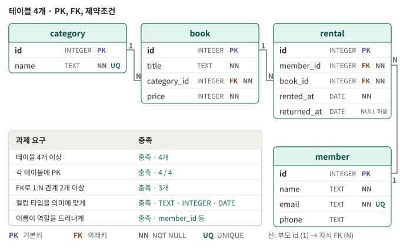
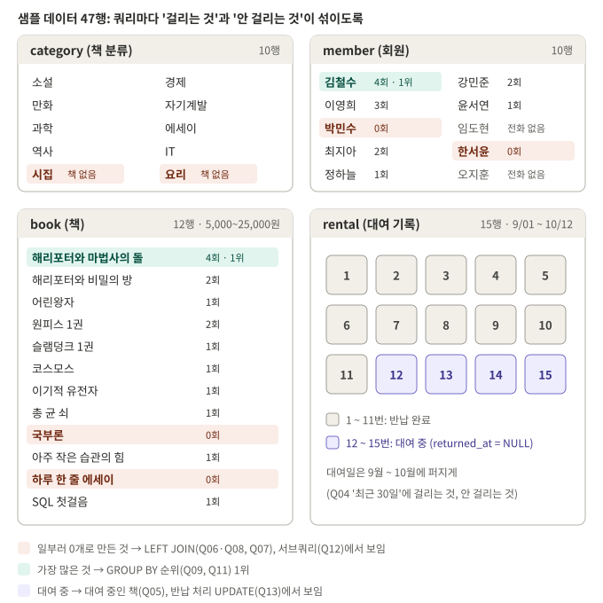
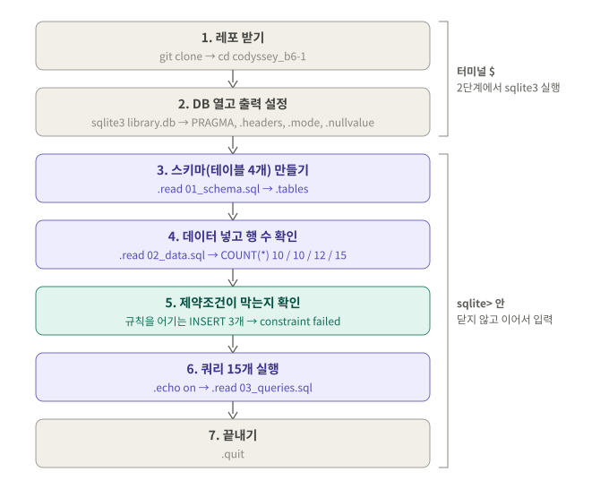
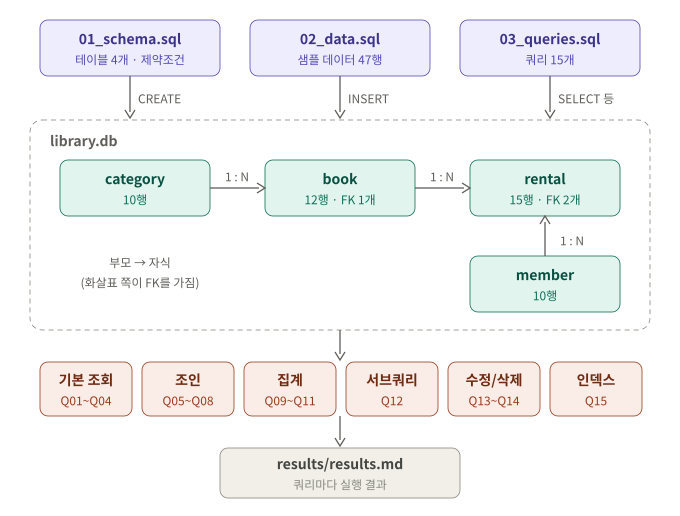

# B6-1 · 정보를 깔끔하게 정리하는 디지털 서랍장 만들기

| 분야 | 구분 | 학습시간 | 필수/선택 |
|---|---|---|---|
| AI/SW 기초 | 데이터베이스와 백엔드 | 40시간 | 필수 |

**주제: 도서 대여 / DB: SQLite / 범위: 필수 요구사항만 (보너스 제외)**

이 README는 세 부분으로 되어 있습니다.

| 순서 | 섹션 | 내용 |
|---|---|---|
| 1 | [데이터 설계](#데이터-설계) | 어떤 컨셉으로 테이블을 나눴고, 샘플 데이터를 어떤 의도로 만들었는지 |
| 2 | [실행과 확인 흐름](#실행과-확인-흐름) | 레포 받기부터 쿼리 15개 결과까지 따라 하는 7단계 |
| 3 | [과제 요구사항 대응](#과제-요구사항-대응) | 과제 문서 1~8의 요구마다 어디에 구현했는지 |

> **평가하시는 분은 [데이터 설계](#데이터-설계)로 구조를 먼저 보고, [실행과 확인 흐름](#실행과-확인-흐름)을 1단계부터 따라 하면 됩니다.**

| 함께 보는 문서 | 내용 |
|---|---|
| [docs/evaluation.md](docs/evaluation.md) | 평가 시연 순서, 평가 항목별 답과 보여줄 곳 |
| [results/results.md](results/results.md) | 쿼리 15개의 실제 실행 결과 |
| [docs/concepts.md](docs/concepts.md) | 과제 목표 6개 개념 정리 (그림 포함) |
| [docs/practice.md](docs/practice.md) | 확인 문제와 내 답, 헷갈렸던 질문, 구현 검토 기록 |

## 진행 상황

| 단계 | 할 일 | 파일 | 상태 |
|---|---|---|---|
| A. 스키마 | 테이블 4개의 칸, 타입, PK/FK, NOT NULL/UNIQUE | `sql/01_schema.sql` | ✅ |
| B. 샘플 데이터 | 테이블마다 10행 이상, 쿼리 결과가 의미 있게 섞기 | `sql/02_data.sql` | ✅ |
| C. 쿼리 15개 | 조회 4, 조인 4, 집계 3, 서브쿼리 1, 수정/삭제 2, 인덱스 1 | `sql/03_queries.sql` | ✅ |
| D. 실행 결과 | 쿼리마다 결과 저장 | `results/results.md` | ✅ |
| E. 개념 복습 | 평가 직전 마지막으로 개념 복습 (서브쿼리 Q12 포함) | `docs/concepts.md` | ⬜ 평가 직전 |

---

## 데이터 설계

### 컨셉: 도서관 대여 장부를 나눠서 저장한다

도서관에서 기록해야 하는 건 **"누가, 어떤 책을, 언제 빌리고, 언제 반납했나"**입니다.
이걸 엑셀 한 시트에 적으면 회원 이름과 책 제목이 대여할 때마다 반복되고, 회원 정보가 바뀌면 모든 줄을 고쳐야 합니다.
그래서 기록할 대상을 **"사람, 책, 책 분류, 빌린 사건"** 네 가지로 나누고, 서로 **번호로 연결**했습니다.

| 테이블 | 무엇을 저장하나 | 한 줄 = |
|---|---|---|
| category | 책 분류 (소설, 만화 등) | 분류 하나 |
| member | 회원 정보 | 회원 한 명 |
| book | 책 정보 (제목, 가격, 어느 분류인지) | 책 한 권 |
| rental | **누가 어떤 책을 언제 빌렸나** | **대여 한 건** (사건) |

rental은 회원과 책을 **연결하는 기록**입니다. 책에 회원 칸을 두면 책 한 권당 한 명밖에 적을 수 없어서, 대여라는 사건을 따로 기록합니다.

### 테이블 구조 (스키마)

**`sql/01_schema.sql`이 하는 일**

| 순서 | 하는 일 |
|---|---|
| 1 | FK 검사를 켠다 (`PRAGMA foreign_keys = ON`) → SQLite는 FK 검사가 **기본으로 꺼져 있어서**, 켜야 없는 번호(예: 999번 회원)를 가리키는 데이터가 막힘. sqlite3를 새로 열면 다시 꺼지므로 파일마다 넣음 |
| 2 | 이미 있는 테이블을 지운다 (`DROP TABLE`, 자식 → 부모: rental → book → member → category). 몇 번이든 다시 실행할 수 있게 |
| 3 | 테이블 4개를 만든다 (`CREATE TABLE`, 부모 → 자식: category → member → book → rental). 이때 PK, FK, NOT NULL, UNIQUE를 같이 정한다 |



| 관계 | 실제 의미 | FK (N 쪽이 가짐) |
|---|---|---|
| category 1 : N book | 분류 하나에 책 여러 권 | `book.category_id → category.id` |
| book 1 : N rental | 책 한 권이 여러 번 대여됨 | `rental.book_id → book.id` |
| member 1 : N rental | 회원 한 명이 여러 번 빌림 | `rental.member_id → member.id` |

| 정한 것 | 이유 |
|---|---|
| `member.email` UNIQUE | 이메일로 회원을 구분. 같은 이메일로 두 번 가입하지 못하게 |
| `category.name` UNIQUE | 같은 이름의 분류가 두 번 생기지 않게 |
| `member.name`에는 UNIQUE 없음 | 동명이인이 있을 수 있음 |
| `rental.returned_at`만 NULL 허용 | 빌리는 순간에는 반납일을 모름. **NULL = 아직 대여 중** |
| 나머지 칸은 NOT NULL | 저장하는 순간 반드시 알 수 있는 값 |
| `book.price`는 INTEGER | 글자로 저장하면 정렬, 비교가 사전 순서로 틀림. SUM, AVG에도 사용 |
| 날짜는 `'YYYY-MM-DD'` | SQLite에는 날짜 타입이 따로 없어 글자로 저장됨. 0을 채우고 큰 단위가 앞이라 글자 순서 = 날짜 순서 |

### 샘플 데이터

**`sql/02_data.sql`이 하는 일**

| 순서 | 하는 일 |
|---|---|
| 1 | FK 검사를 켠다 (`PRAGMA foreign_keys = ON`) → SQLite는 FK 검사가 **기본으로 꺼져 있어서**, 켜야 없는 번호(예: 999번 회원)를 가리키는 데이터가 막힘. sqlite3를 새로 열면 다시 꺼지므로 파일마다 넣음 |
| 2 | 테이블마다 `INSERT` 한 번으로 여러 행을 넣는다 (부모 → 자식: category 10 → member 10 → book 12 → rental 15, 모두 47행) |

각 테이블 10행 이상(과제 요구)이고, **쿼리를 실행했을 때 "걸리는 것"과 "안 걸리는 것"이 둘 다 있도록** 일부러 섞었습니다.
예를 들어 모든 회원이 책을 빌렸다면 "대여 기록이 없는 회원 찾기"(Q12)는 빈 결과가 나와서 쿼리가 맞는지 보여줄 수 없습니다.



| 일부러 섞은 데이터 | 어떤 행 | 결과로 보이는 쿼리 |
|---|---|---|
| 책이 한 권도 없는 분류 | 시집, 요리 | Q06(JOIN, 12줄)과 Q08(LEFT JOIN, 14줄)의 차이 |
| 한 번도 안 빌린 회원 | 박민수, 한서윤 | Q07(LEFT JOIN에서 NULL), Q12(서브쿼리) |
| 한 번도 안 빌린 책 | 국부론, 하루 한 줄 에세이 | Q11 순위에 없음 |
| 아직 반납 안 한 대여 | rental 12~15번 | Q05(대여 중인 책), Q13(반납 처리 UPDATE) |
| 많이 빌린 회원과 책 | 김철수 4회, 해리포터와 마법사의 돌 4회 | Q09, Q11 순위 1위 |
| 가격 5,000 ~ 25,000원 | book 전체 | Q01(범위), Q03(TOP 3), Q10(합계, 평균) |
| 제목에 같은 단어 | "해리포터" 2권 | Q02(LIKE 검색) |
| 대여일 9월 ~ 10월 | rental 전체 | Q04(최근 30일) |
| 전화번호 없는 회원 | 임도현, 오지훈 | phone이 NULL 허용인지 |

**넣는 순서**: 부모 테이블이 먼저 있어야 자식이 그 번호를 가리킬 수 있어서 **category → member → book → rental** 순서로 넣습니다. (`01_schema.sql`이 만드는 순서도 같음)

### 쿼리

**`sql/03_queries.sql`이 하는 일**

| 순서 | 하는 일 |
|---|---|
| 1 | FK 검사를 켠다 (`PRAGMA foreign_keys = ON`) → SQLite는 FK 검사가 **기본으로 꺼져 있어서**, 켜야 없는 번호(예: 999번 회원)를 가리키는 데이터가 막힘. sqlite3를 새로 열면 다시 꺼지므로 파일마다 넣음 |
| 2 | 데이터를 **읽는** 쿼리 Q01~Q12 (기본 조회, 조인, 집계, 서브쿼리) |
| 3 | 데이터를 **바꾸는** 쿼리 Q13(UPDATE), Q14(DELETE). 바뀐 결과를 보여주는 확인용 SELECT를 하나씩 붙임 |
| 4 | 인덱스를 만드는 Q15 (CREATE INDEX)와 확인용 PRAGMA |

읽기를 먼저, 바꾸기를 나중에 둬서 읽는 쿼리의 결과가 바뀐 데이터와 섞이지 않게 했습니다. 쿼리별 내용은 [4-5](#4-5-핵심-sql-쿼리-15개), 실제 결과는 [results/results.md](results/results.md)에 있습니다.

---

## 실행과 확인 흐름

**스키마 만들기 → 데이터 넣고 확인 → 규칙이 막는지 확인 → 쿼리 실행** 순서입니다.
쿼리 Q13, Q14가 데이터를 **바꾸기** 때문에 쿼리는 맨 마지막에 실행합니다. (먼저 실행하면 4단계의 "회원 10명"이 9명으로 보임)



**어디에 입력하나요?**

| 표시 | 어디 | 언제 |
|---|---|---|
| `$` | 터미널 | 1단계, 2단계의 앞부분 |
| `sqlite>` | `sqlite3 library.db`를 실행한 뒤 나오는 SQLite 화면 | 2단계 뒷부분부터 7단계까지 |

- `sqlite>`에서 **점(`.`)으로 시작하는 명령**(`.read`, `.tables` 등)은 SQL이 아니라 sqlite3 프로그램의 명령입니다. 세미콜론을 붙이지 않고, **같은 줄에 주석을 붙이면 안 됩니다.**
- SQL 문장(`SELECT ...;`, `PRAGMA ...;`)은 세미콜론(`;`)으로 끝냅니다.
- 2~7단계는 **한 번 연 `sqlite>`를 닫지 않고 이어서** 진행합니다.

### 1단계. 레포 받기

**무엇을**: GitHub의 레포를 내 컴퓨터에 받고, 그 폴더로 이동합니다.
**왜**: 이후 `.read sql/01_schema.sql` 같은 명령이 **지금 있는 폴더 기준**으로 파일을 찾기 때문입니다.

```bash
git clone https://github.com/codewhite7777/codyssey_b6-1.git
cd codyssey_b6-1
ls
```

**결과**: `README.md  docs  results  sql`이 보이면 됩니다. 이미 받아 둔 레포가 있으면 그 폴더에서 `git pull`만 합니다.

### 2단계. DB 열고 출력 설정하기

**무엇을**: 빈 DB 파일을 새로 열고, 결과가 보기 좋게 나오도록 설정합니다.
**왜**: 이전에 실행한 DB가 남아 있으면 쿼리가 바꾼 데이터가 섞이므로 지우고 새로 시작합니다. 그리고 SQLite는 **FK 검사가 기본으로 꺼져 있어서** 직접 켜야 합니다.

터미널(`$`)에서:

```bash
sqlite3 --version
rm -f library.db
sqlite3 library.db
```

`sqlite>`가 나오면 아래를 한 줄씩 입력합니다.

```sql
PRAGMA foreign_keys = ON;
.headers on
.mode table
.nullvalue NULL
```

| 명령 | 하는 일 |
|---|---|
| `sqlite3 --version` | SQLite가 설치돼 있는지 확인 (macOS 기본 설치, `3.xx` 숫자가 나오면 OK) |
| `rm -f library.db` | 이전에 만든 DB 파일 삭제 (없으면 아무 일도 안 함) |
| `sqlite3 library.db` | `library.db`를 열고 `sqlite>` 화면으로 들어감. 파일이 없으면 새로 만듦 |
| `PRAGMA foreign_keys = ON;` | **FK 검사 켜기.** 꺼져 있으면 5단계의 "없는 회원 참조"가 막히지 않음 |
| `.headers on` | 결과 맨 위에 칸 이름 표시 |
| `.mode table` | 결과를 테두리 있는 표로 출력 (오래된 SQLite에서 에러가 나면 `.mode column`) |
| `.nullvalue NULL` | NULL을 빈칸 대신 `NULL` 글자로 표시 (LEFT JOIN 결과를 보기 위해) |

**결과**: 아무것도 출력되지 않으면 정상입니다.

### 3단계. 스키마(테이블 4개) 만들기

**무엇을**: [테이블 구조](#테이블-구조-스키마) 그림대로 테이블 4개를 만듭니다.
**왜**: 데이터를 넣을 빈 테이블이 먼저 있어야 하기 때문입니다.

```sql
.read sql/01_schema.sql
.tables
```

| 명령 | 하는 일 |
|---|---|
| `.read sql/01_schema.sql` | 파일 안의 SQL을 위에서부터 실행. 기존 테이블이 있으면 지우고(DROP) category → member → book → rental 순서로 새로 만듦 |
| `.tables` | 만들어진 테이블 목록 보기 |

**결과**: `book  category  member  rental` (4개)

### 4단계. 샘플 데이터 넣고 행 수 확인하기

**무엇을**: [샘플 데이터](#샘플-데이터)를 넣고, 테이블마다 몇 행인지 셉니다.
**왜**: 과제 요구가 "각 테이블 10행 이상"이기 때문입니다.

```sql
.read sql/02_data.sql
SELECT (SELECT COUNT(*) FROM category) AS category, (SELECT COUNT(*) FROM member) AS member, (SELECT COUNT(*) FROM book) AS book, (SELECT COUNT(*) FROM rental) AS rental;
```

**결과** (실제 출력)

```text
+----------+--------+------+--------+
| category | member | book | rental |
+----------+--------+------+--------+
| 10       | 10     | 12   | 15     |
+----------+--------+------+--------+
```

두 번째 줄은 네 테이블의 `COUNT(*)`를 한 줄로 보려고 묶은 것입니다. `SELECT COUNT(*) FROM member;`처럼 하나씩 실행해도 같습니다.

### 5단계. 제약조건이 막는지 확인하기

**무엇을**: [테이블 구조](#테이블-구조-스키마)에서 정한 규칙을 어기는 데이터를 일부러 넣어 봅니다. **세 줄 모두 에러가 나야 정상**입니다.
**왜**: 과제 요구가 "NOT NULL, UNIQUE 적용"과 "없는 값 참조가 실제로 막혀야 한다"이기 때문입니다.

```sql
INSERT INTO member (id, name, email) VALUES (99, NULL, 'x@example.com');
INSERT INTO member (id, name, email) VALUES (99, '홍길동', 'member01@example.com');
INSERT INTO rental (id, member_id, book_id, rented_at) VALUES (99, 999, 1, '2026-10-14');
```

**결과** (실제 출력)

```text
Runtime error: NOT NULL constraint failed: member.name (19)
Runtime error: UNIQUE constraint failed: member.email (19)
Runtime error: FOREIGN KEY constraint failed (19)
```

SQLite 버전에 따라 앞부분이 `Error:`나 `Runtime error near line ...:`로 나올 수 있습니다. **`... constraint failed`가 보이면 막힌 것**입니다.

| 줄 | 넣으려던 것 | 막은 규칙 |
|---|---|---|
| 1 | 이름 없는 회원 | `member.name` NOT NULL |
| 2 | 이미 있는 이메일 `member01@example.com` | `member.email` UNIQUE |
| 3 | 없는 회원 999번의 대여 기록 | `rental.member_id → member.id` FK |

정말 저장되지 않았는지도 확인합니다.

```sql
SELECT COUNT(*) FROM member WHERE id = 99;
SELECT COUNT(*) FROM rental WHERE id = 99;
```

**결과**: 둘 다 `0`. 막힌 INSERT는 저장되지 않았습니다.

### 6단계. 쿼리 15개 실행하기

**무엇을**: 쿼리 15개를 실행하고 결과 표를 봅니다.
**왜**: 과제의 핵심 쿼리 15개(조회 4, 조인 4, 집계 3, 서브쿼리 1, 수정/삭제 2, 인덱스 1)와 실행 결과를 확인하기 위해서입니다.

```sql
.echo on
.read sql/03_queries.sql
```

| 명령 | 하는 일 |
|---|---|
| `.echo on` | 실행하는 SQL을 결과 위에 같이 출력. `-- Q01. [기본 조회] ...` 설명 줄도 나와서 **어떤 표가 몇 번 쿼리인지** 알 수 있음 |
| `.read sql/03_queries.sql` | Q01부터 Q15까지 차례로 실행 |

**결과**: 화면에 `-- Q01. ...` 설명, SQL, 결과 표가 Q15까지 차례로 나옵니다. 결과는 [results/results.md](results/results.md)와 같아야 합니다. 쿼리 목록은 [4-5](#4-5-핵심-sql-쿼리-15개)에 있습니다.

- **값은 같아도 줄 순서가 다를 수 있습니다.** 같은 분류 안의 책 순서(Q06, Q08)나 동점끼리의 순서(Q09, Q11)는 `ORDER BY`로 정하지 않아서, SQLite 버전에 따라 results.md와 순서만 다르게 나올 수 있습니다.
- Q13(UPDATE), Q14(DELETE), Q15(CREATE INDEX)는 결과 표가 없습니다. 바로 아래의 **확인용 SELECT/PRAGMA**(15개에 세지 않음)가 바뀐 결과를 보여줍니다.
- 쿼리 하나만 다시 보고 싶으면 `sql/03_queries.sql`에서 그 SQL을 복사해 `sqlite>`에 붙여넣습니다. 단, Q13, Q14 실행 뒤에는 데이터가 바뀌어 있습니다 (예: 한서윤 삭제). 처음 상태로 보려면 7단계 후 2단계부터 다시 합니다.

### 7단계. 끝내기

```sql
.quit
```

`sqlite>`를 끝내고 터미널로 돌아갑니다. `library.db` 파일은 SQL 파일로 언제든 다시 만들 수 있어서 레포에 올리지 않습니다 (`.gitignore`).

---

## 과제 요구사항 대응

과제 문서 1~8의 순서대로, 요구마다 어디에 구현했는지 정리합니다.

### 1. 미션 소개

도서관에서 **회원이 책을 빌리고 반납하는 기록**을 DB로 관리합니다.
백엔드 프레임워크 없이 SQL만으로 **데이터 모델링 → 데이터 입력 → 요구사항을 SQL로 해결**하는 흐름을 완성합니다.

### 2. 최종 결과물

| 과제 요구 | 파일 | 상태 |
|---|---|---|
| 도메인 DB 1개 (테이블 4개 이상, 1:N 2개 이상) | 도서 대여 DB: 테이블 4개, 1:N 3개 | ✅ |
| 스키마 생성 스크립트 1개 | [sql/01_schema.sql](sql/01_schema.sql) | ✅ |
| 샘플 데이터 입력 스크립트 1개 (테이블당 10행 이상) | [sql/02_data.sql](sql/02_data.sql) | ✅ |
| 핵심 쿼리 15개 | [sql/03_queries.sql](sql/03_queries.sql) | ✅ |
| 실행 결과 캡처 폴더 | [results/results.md](results/results.md) | ✅ |
| (선택) ERD | [테이블 구조](#테이블-구조-스키마) 그림, 아래 구현 구조 그림 | ✅ |



```text
codyssey_b6-1/
├── README.md            데이터 설계, 실행과 확인 흐름, 과제 요구사항 대응
├── sql/
│   ├── 01_schema.sql    CREATE TABLE (부모 → 자식 순서)
│   ├── 02_data.sql      INSERT (부모 → 자식 순서)
│   └── 03_queries.sql   핵심 쿼리 15개
├── results/
│   └── results.md       쿼리 실행 결과
└── docs/
    ├── evaluation.md    평가 준비
    ├── concepts.md      개념 정리
    ├── practice.md      연습과 검토 기록
    └── images/          그림
```

### 3. 과제 목표

**1. DB가 엑셀과 뭐가 다른지, 왜 테이블로 나누는지**
- 엑셀 한 시트에 회원, 책, 대여를 다 적으면 회원 정보가 대여할 때마다 반복되고, 틀린 값(빈 이름, 없는 회원 번호)도 그냥 들어갑니다.
- DB는 **주제별 테이블로 나누고 번호로 연결**합니다. 회원 정보는 member에 한 번만 있고, 규칙(NOT NULL, UNIQUE, FK)을 어기는 값은 저장 자체를 막습니다.
- 이 레포: [컨셉](#컨셉-도서관-대여-장부를-나눠서-저장한다)의 4개 테이블, [5단계](#5단계-제약조건이-막는지-확인하기)에서 규칙을 어긴 INSERT 3개가 모두 막힘

**2. PK/FK와 1:N 관계**
- **PK** = 그 테이블에서 한 줄을 가리키는 **내 번호** (`member.id`). 겹치지 않고 비어 있지 않음
- **FK** = 다른 테이블의 PK를 적어 둔 **남의 번호** (`rental.member_id`). 없는 번호는 못 넣음
- **1:N** = 한쪽 1줄에 다른 쪽 여러 줄이 붙는 관계. FK는 N 쪽에 둠
- 이 레포: 김철수(`member.id` = 1) 1명 → rental 1, 3, 6, 12번 4건이 `member_id = 1`을 가짐. 관계 3개는 [테이블 구조](#테이블-구조-스키마)

**3. SELECT / INSERT / UPDATE / DELETE 구분**

| 명령 | 하는 일 | 이 레포 |
|---|---|---|
| SELECT | 읽기 (데이터는 그대로) | Q01~Q12 |
| INSERT | 새 줄 넣기 | `02_data.sql` |
| UPDATE | 있는 줄의 값 고치기 | Q13: 15번 대여에 반납일 채우기 |
| DELETE | 줄 지우기 | Q14: 한서윤(9번) 삭제 |

UPDATE와 DELETE는 `WHERE`가 없으면 **모든 줄**이 바뀌거나 지워지므로 항상 `WHERE`로 대상을 정합니다.

**4. JOIN과 GROUP BY**
- **JOIN** = 번호가 같은 줄끼리(`ON` 조건) 옆으로 붙여 한 표로 만듦
  - INNER `JOIN`: 짝이 있는 줄만 남음
  - `LEFT JOIN`: `FROM`에 쓴 표의 줄은 모두 남고, 짝이 없으면 NULL
  - 이 레포: Q06(JOIN) 12줄 vs Q08(LEFT JOIN) 14줄. 늘어난 2줄 = 책 없는 시집, 요리
- **GROUP BY** = 같은 값끼리 더미로 나누고, 더미마다 `COUNT`(개수), `SUM`(합계), `AVG`(평균)를 계산
  - 이 레포: Q10 카테고리별 책 수, 가격 합계, 평균 가격

**5. 검색 / 정렬 / 집계 / 랭킹**

| 하고 싶은 것 | SQL | 이 레포 |
|---|---|---|
| 검색 (조건에 맞는 줄만) | `WHERE` (`>=`, `LIKE`, `IS NULL`), 서브쿼리 | Q01, Q02, Q04, Q05, Q12 |
| 정렬 | `ORDER BY ... DESC`(큰 순) / `ASC`(작은 순) | Q01, Q04 |
| 집계 | `GROUP BY` + `COUNT`, `SUM`, `AVG` | Q09, Q10 |
| 랭킹 (TOP N) | `ORDER BY ... DESC` + `LIMIT N` (집계한 값으로도 가능) | Q03(가격 TOP 3), Q11(대여 횟수 TOP 3) |

Q12(서브쿼리): 괄호 안 `SELECT member_id FROM rental`로 **빌린 적 있는 회원 번호 목록**을 먼저 만들고, 바깥에서 그 목록에 **없는**(`NOT IN`) 회원만 고릅니다.

**6. 인덱스가 왜 필요한지, 어디에 거는지**
- 인덱스 = 책 뒤의 **찾아보기**. "값 → 그 값이 있는 줄 위치"를 미리 정리해 둠. 없으면 표를 처음부터 끝까지 확인해야 함
- **자주 찾거나 JOIN에 쓰는 칸**에 겁니다. 결과는 그대로이고 찾는 속도만 바뀝니다
- 아무 칸에나 걸지 않는 이유: 넣고 고칠 때마다 인덱스도 고쳐야 해서 INSERT, UPDATE가 느려짐
- 이 레포: Q15에서 `rental.member_id`에 걸었습니다. Q07, Q12처럼 회원 번호로 대여 기록을 찾기 때문입니다 (PK인 `id`는 자동으로 인덱스가 있음)

> 그림과 연습 문제가 있는 더 자세한 설명: [docs/concepts.md](docs/concepts.md)

### 4. 기능 요구 사항

#### 4-1. DB 환경 준비

| 요구 | 선택 | 이유 |
|---|---|---|
| 로컬 DB 1개 | SQLite | macOS에 기본 설치, 파일 하나가 DB라 서버 실행이 필요 없음 |
| SQL 실행 도구 | 터미널 CLI (`sqlite3`) | 별도 설치 없이 바로 실행, 결과를 텍스트로 확인하기 쉬움 |

실행 방법은 [1~2단계](#1단계-레포-받기). DB 전용 문법(`PRAGMA` 등)은 SQL 파일에 "SQLite 전용"으로 표시했습니다.

#### 4-2. 데이터 모델(스키마) 설계

| 요구 | 충족 | 어디서 |
|---|---|---|
| 테이블 4개 이상 | ✅ 4개 | [테이블 구조](#테이블-구조-스키마), [3단계](#3단계-스키마테이블-4개-만들기) |
| 각 테이블에 PK | ✅ 4개 모두 `id` | [테이블 구조](#테이블-구조-스키마) |
| FK로 1:N 관계 2개 이상 | ✅ 3개 | [테이블 구조](#테이블-구조-스키마)의 관계 표 |
| 컬럼 타입을 의미에 맞게 | ✅ 글자 TEXT, 숫자 INTEGER, 날짜 DATE | [테이블 구조](#테이블-구조-스키마)의 정한 것 표 |
| 이름이 역할을 드러내게 | ✅ `member_id`, `rented_at`, `returned_at` 등 | `sql/01_schema.sql` |

#### 4-3. 제약조건 적용

| 요구 | 적용한 곳 | 확인 |
|---|---|---|
| NOT NULL 1개 이상 | `category.name`, `member.name`, `member.email`, `book`의 칸 전부, `rental`에서 `returned_at`을 뺀 칸 | [5단계](#5단계-제약조건이-막는지-확인하기) 1번째 줄 |
| UNIQUE 1개 이상 | `member.email`, `category.name` | 5단계 2번째 줄 |
| FK가 실제로 동작 | `PRAGMA foreign_keys = ON` + `REFERENCES` 3개 | 5단계 3번째 줄 |

#### 4-4. 샘플 데이터 준비

| 요구 | 충족 | 어디서 |
|---|---|---|
| 각 테이블 10행 이상 | ✅ 10 / 10 / 12 / 15행 | [샘플 데이터](#샘플-데이터), [4단계](#4단계-샘플-데이터-넣고-행-수-확인하기) |
| FK로 연결된 데이터가 실제로 관계를 가짐 | ✅ rental의 member_id, book_id는 모두 있는 번호 | 5단계에서 없는 번호는 막힘 |
| 부모 테이블 먼저 입력 | ✅ category → member → book → rental | `sql/02_data.sql` |

#### 4-5. 핵심 SQL 쿼리 15개

[sql/03_queries.sql](sql/03_queries.sql)에 쿼리마다 "무엇을 확인하는지" 한 줄 설명을 붙였습니다. 실행은 [6단계](#6단계-쿼리-15개-실행하기).

| 범주 | 필요 개수 | 쿼리 | 무엇을 확인하나 | 결과 |
|---|---|---|---|---|
| 기본 조회 | 4개 이상 | Q01 | 15,000원 이상인 책, 비싼 순 (WHERE, ORDER BY) | 8줄 |
| | | Q02 | 제목에 "해리포터"가 들어간 책 (LIKE) | 2줄 |
| | | Q03 | 가장 비싼 책 TOP 3 (ORDER BY, LIMIT) | 3줄 |
| | | Q04 | 최근 30일 대여 기록, 최신순 | 10줄 |
| 조인 | 4개 이상 (INNER 2, LEFT 1 이상) | Q05 | INNER: 대여 중인 책 목록 | 4줄 |
| | | Q06 | INNER: 분류별 책 (책 있는 분류만) | 12줄 |
| | | Q07 | LEFT: 대여 기록 없는 회원도 포함한 회원별 대여 번호 | 17줄 (NULL 2) |
| | | Q08 | LEFT: 책 없는 분류도 포함한 분류별 책 (Q06과 LEFT 한 단어만 다름) | 14줄 (NULL 2) |
| 집계 | 3개 이상 (COUNT, SUM, AVG 중 2개 이상) | Q09 | 회원별 대여 횟수, 많은 순 (COUNT) | 8줄 |
| | | Q10 | 분류별 책 수, 가격 합계, 평균 (COUNT, SUM, AVG) | 8줄 |
| | | Q11 | 가장 많이 대여된 책 TOP 3 | 3줄 |
| 서브쿼리 | 1개 이상 | Q12 | 대여 기록이 없는 회원 (NOT IN) | 2줄 |
| 수정 및 삭제 | 2개 이상 | Q13 | UPDATE: 15번 대여 반납 처리 | 1줄 변경 |
| | | Q14 | DELETE: 대여 기록 없는 회원 한서윤 삭제 | 1줄 삭제 |
| 인덱스 | 1개 이상 | Q15 | `rental.member_id`에 인덱스 + 이유 | 생성 |

- 날짜 기준일은 `2026-10-14`로 고정했습니다. "오늘"을 구하는 함수는 DB 전용 문법이고 실행하는 날마다 결과가 바뀌기 때문입니다.
- UPDATE, DELETE, CREATE INDEX 뒤에는 바뀐 걸 보여주는 **확인용 SELECT/PRAGMA**를 붙였습니다 (15개에 세지 않음).
- 읽기(Q01~Q12)를 먼저, 바꾸기(Q13~Q14)를 나중에 둬서 결과가 섞이지 않게 했습니다.

#### 4-6. 결과 확인 자료

[results/results.md](results/results.md)에 쿼리 15개와 확인용 SELECT/PRAGMA의 결과를 sqlite3로 실행한 출력 그대로 SQL과 함께 저장했습니다.

### 5. 보너스 과제

이번 범위에서는 하지 않습니다. 필수 요구사항에 집중합니다.

### 6. 개발 환경

| 항목 | 사용 |
|---|---|
| OS | macOS |
| DB | SQLite 3 (macOS 기본 설치) |
| 실행 도구 | 터미널 `sqlite3` CLI |

### 7. 제약 사항

| 제약 | 지킨 방법 |
|---|---|
| 백엔드 프레임워크 사용 금지 | SQL 파일 3개만 사용 |
| 로컬 DB만 사용 | SQLite 파일 DB |
| 뷰, 프로시저, 트리거 사용 금지 | 사용하지 않음 |
| 정규화를 과하게 파지 않기 | 테이블 4개, 관계가 자연스럽고 쿼리가 잘 나오는 구조 |

### 8. 결과 예시와 대응

| 과제 예시 | 이 DB의 쿼리 |
|---|---|
| 대여 중인 책 목록 | Q05 (`returned_at`이 NULL인 대여 + 책 제목) |
| 회원별 대여 횟수 집계 | Q09 |
| 최근 30일 대여 기록 | Q04 |
| 연체 상태로 업데이트 | Q13. 이 설계에는 상태 칸이 없어 **반납 처리**(`returned_at` 채우기)로 대신함 |
| 대여 기록이 없는 회원 찾기 (서브쿼리) | Q12 |
