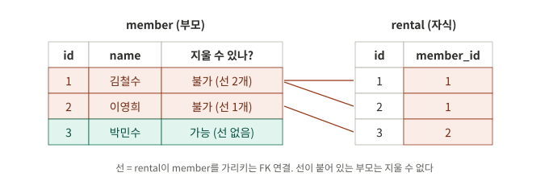
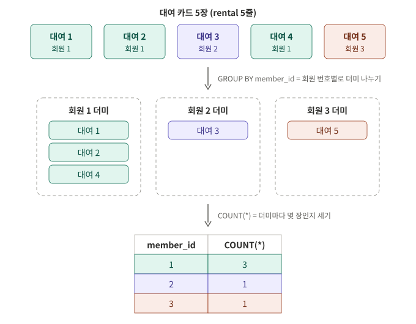
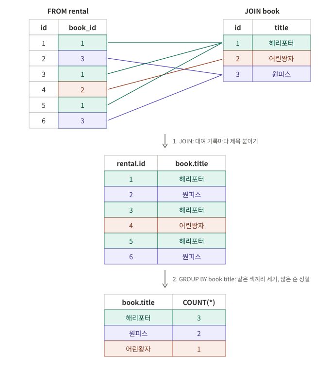
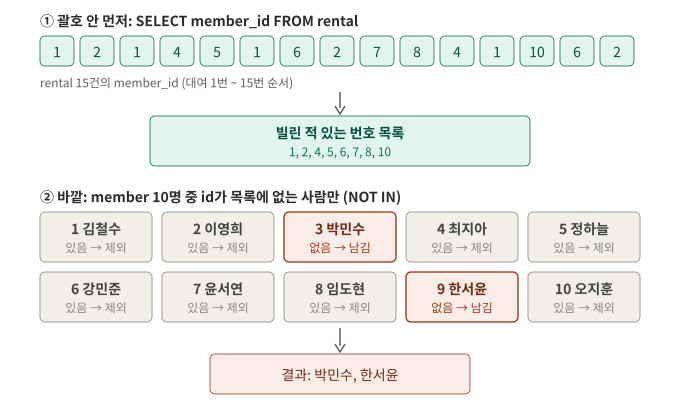
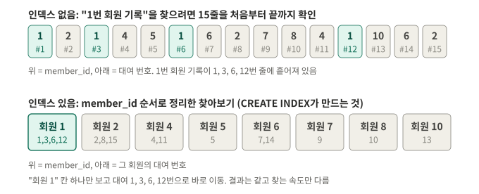

# 개념 정리

과제 **3. 과제 목표**의 6개 항목을, 공부한 순서대로 정리한 문서입니다.
예시는 모두 "원본 표 → 짝 맞추기 → 결과 표"처럼 **실제 데이터로 따라가는 방식**으로 적었습니다.

[← README (과제 진행)](../README.md) · [연습 기록](practice.md)

## 학습 단계

| 단계 | 내용 | 과제 목표 | 상태 |
|---|---|---|---|
| 0 | DB와 엑셀의 차이 | 1 | ✅ |
| 1 | DB 환경 준비 (SQLite) | - | ✅ |
| 2 | 스키마 설계 (PK, FK, 1:N) | 2 | ✅ |
| 3 | 제약조건 (NOT NULL, UNIQUE, FK) | 2 | ✅ |
| 4 | 샘플 데이터 (INSERT) | 3 | ✅ |
| 5-1 | 기본 조회 (WHERE, ORDER BY, LIMIT) | 3, 5 | ✅ |
| 5-2 | JOIN (INNER, LEFT) | 4 | ✅ |
| 5-3 | 집계 (COUNT, SUM, AVG + GROUP BY) | 4, 5 | ✅ |
| 5-4 | 서브쿼리 | 5 | ✅ 구현 후 복습 (연습 문제 정답) |
| 5-5 | UPDATE / DELETE | 3 | ✅ |
| 5-6 | 인덱스 | 6 | ✅ |

서브쿼리는 과제 구현을 마친 뒤, 완성된 Q12를 "사람이라면 어떻게 찾나" 두 단계로 바꿔 보며 다시 정리했습니다.

---

## 1. DB는 엑셀과 뭐가 다른가, 왜 테이블로 나눠 저장하나

엑셀 한 시트에 대여 기록을 모두 적으면 이렇게 됩니다.

| 회원이름 | 전화번호 | 책제목 | 대여일 |
|---|---|---|---|
| 김철수 | 010-1111 | 해리포터 | 10/01 |
| 김철수 | 010-1111 | 어린왕자 | 10/05 |
| 이영희 | 010-2222 | 해리포터 | 10/07 |

- **중복**: 김철수의 정보가 대여할 때마다 반복됩니다.
- **수정 문제**: 번호가 바뀌면 모든 줄을 고쳐야 하고, 하나라도 빠뜨리면 데이터가 서로 안 맞습니다.
- **잘못된 입력**: 없는 회원이나 오타를 적어도 막지 않습니다.

DB는 **주제별로 테이블을 나누고, 번호로 연결**합니다. 회원 정보는 member에 한 번만 있고, rental은 이름 대신 `member_id`(번호)만 갖습니다.

| 질문 | 엑셀 | DB |
|---|---|---|
| 각 행을 구분하는 번호 | 행 번호는 **위치**라 정렬하면 바뀜 | PK는 데이터에 붙은 **이름표**라 안 바뀜 |
| 없는 회원 번호 99를 적으면 | 그냥 저장됨 | **FK가 막음** |
| 빈 이름, 중복 이메일 | 그냥 저장됨 | **제약조건이 막음** |

PK는 엑셀에서도 id 열을 만들어 흉내 낼 수 있습니다. 결정적인 차이는 **FK와 제약조건으로 관계와 규칙을 DB가 강제한다**는 점입니다.

> 주의: SQLite는 **타입은 엄격하게 지키지 않습니다.** `INTEGER` 칸에 `'abc'`를 넣어도 대부분 저장됩니다 (`INTEGER PRIMARY KEY` 제외). 반면 NOT NULL, UNIQUE, FK 같은 **제약조건을 어기면 거부**합니다.

## 2. PK / FK / 1:N 관계는 데이터를 어떻게 연결하나

- **PK (기본키)**: 각 행을 구분하는 고유 번호. 비어 있을 수 없고 겹칠 수 없음 (= NOT NULL + UNIQUE).
- **FK (외래키)**: 다른 테이블의 PK를 가리키는 칸. 예: `rental.member_id → member.id`
- **1:N**: 한쪽 1개가 반대쪽 여러 개와 연결되는 관계. **FK는 항상 N(여러 개) 쪽에 둡니다.**

**왜 FK가 N 쪽에 있어야 하나**: book에 `member_id`를 넣으면 책 한 권당 회원 칸이 하나뿐이라, 해리포터를 빌린 김철수와 이영희 중 한 명만 적을 수 있습니다.
그래서 "누가 어떤 책을 언제 빌렸다"는 **사건 자체를 rental에 기록**하고, rental이 `member_id`와 `book_id`를 모두 들고 있습니다.

### 제약조건: 이런 데이터는 받지 않는다

| 제약 | 의미 | 이 설계에서 |
|---|---|---|
| `NOT NULL` | 빈 값 금지 | 이름 없는 회원은 이상함 → `member.name` |
| `UNIQUE` | 중복 금지 | 이메일로 회원을 구분 → `member.email` |
| `FOREIGN KEY` | 없는 번호 참조 금지 | `rental.member_id`, `rental.book_id`, `book.category_id` |

- 한 컬럼에 여러 개를 같이 걸 수 있습니다: `email TEXT NOT NULL UNIQUE` (UNIQUE만 걸면 빈 값은 막지 않음).
- 판단 기준: **"이 값이 없으면 안 되나?" → NOT NULL**, **"이 값으로 사람을 구분하나?" → UNIQUE**.
- 제약조건은 정답이 정해진 게 아니라 **서비스 규칙을 DB에 옮기는 것**입니다. (예: 가족이 전화번호를 같이 쓸 수 있으면 phone에는 UNIQUE를 걸지 않음)
- **SQLite는 FK 검사가 기본으로 꺼져 있어서** `PRAGMA foreign_keys = ON;`을 먼저 실행해야 없는 값 참조가 막힙니다.

### 데이터 넣는 순서: 부모 먼저

rental에 `member_id = 1`을 넣으려면 member에 1번 회원이 **이미 있어야** 합니다.

```sql
INSERT INTO rental (id, member_id, book_id, rented_at) VALUES (1, 1, 1, '2026-10-01');
-- member, book이 비어 있으면 → Error: FOREIGN KEY constraint failed
```

- **에러 난 INSERT는 저장되지 않습니다.** 그래서 그 행을 가리키는 뒷줄도 연달아 실패합니다. 에러가 여러 개면 맨 위부터 고칩니다.
- 여러 줄을 한 번에 넣다가 **한 줄만 틀려도 그 INSERT 문 전체가 취소**됩니다.

## 3. SELECT / INSERT / UPDATE / DELETE는 언제 쓰나

| 명령 | 언제 | 정리한 단계 |
|---|---|---|
| `INSERT` | 새 행을 추가할 때 | 4단계 ✅ |
| `SELECT` | 저장된 데이터를 꺼내 볼 때 | 5-1단계 ✅ |
| `UPDATE` | 이미 있는 행의 값을 바꿀 때 | 5-5단계 ✅ |
| `DELETE` | 행 자체를 지울 때 | 5-5단계 ✅ |

SELECT만 원본을 바꾸지 않고, 나머지 셋은 원본이 실제로 바뀝니다.

**INSERT 읽는 법**

```sql
INSERT INTO member (id, name, email, phone)        -- member 표에, 이 순서의 칸으로 넣겠다 (선언)
VALUES (1, '김철수', 'kim@a.com', '010-1111-1111'); -- 선언한 순서대로 값
```

**SELECT 쓰는 순서와 실행 순서는 다릅니다.**

```text
쓰는 순서:  SELECT → FROM → (JOIN … ON) → WHERE → GROUP BY → ORDER BY → LIMIT
실행 순서:  FROM → (JOIN … ON) → WHERE → GROUP BY → SELECT → ORDER BY → LIMIT
```

DB는 **어느 표에서(FROM) → 붙이고(JOIN) → 걸러내고(WHERE) → 묶고(GROUP BY) → 칸을 고르고(SELECT) → 정렬하고 → 자릅니다.**
SQL은 세미콜론(`;`)까지를 **한 문장**으로 끝까지 읽은 뒤 실행하기 때문에, 맨 앞에 쓴 SELECT가 뒤의 JOIN 결과에서 칸을 고를 수 있습니다.

**SELECT 뒤에 쓰는 규칙 5개**

1. 칸은 **쉼표**로 나눈다. 마지막 칸 뒤에는 쉼표를 쓰지 않는다.
2. **꺼낸 표(FROM, JOIN)의 칸만** 쓸 수 있다. (`FROM rental`에서 `name`을 쓰면 `no such column`)
3. 같은 이름의 칸이 두 표에 있으면 **`테이블.칸`**으로 쓴다. (`id`만 쓰면 `ambiguous column name`)
4. GROUP BY를 쓰면 **묶은 기준 칸 + 집계 함수**만 쓴다.
5. SELECT에 쓴 순서 = 결과 표의 칸 순서.

> **SELECT는 결과의 칸을, 나머지(FROM, JOIN, ON, WHERE)는 결과의 줄을 정한다.** `SELECT A, B, C` 뒤에 무엇이 오든 결과는 항상 `[A, B, C]` 형태다.
> `테이블.필드`에서 **테이블은 FROM, JOIN에 적힌 테이블**, **필드는 그 테이블에 실제로 있는 칸**이어야 한다.

> 쉼표를 빠뜨려 `SELECT id member_id`처럼 쓰면 에러 없이 "id 칸을 member_id라는 이름으로 보여줘"로 해석됩니다. 조용히 틀린 결과가 나오니 더 위험합니다.

### UPDATE: 이미 있는 값 바꾸기

```sql
UPDATE rental                       -- rental 표에서
SET returned_at = '2026-10-14'      -- returned_at 칸을 이 값으로 바꿔라
WHERE id = 3;                       -- 단, id가 3인 줄만
```

### DELETE: 줄 자체를 지우기

```sql
DELETE FROM rental WHERE id = 1;
```

### WHERE를 빠뜨리면 전체가 바뀐다

`UPDATE rental SET returned_at = '2026-10-14';`는 **모든 줄**을, `DELETE FROM rental;`은 **모든 줄을 삭제**합니다. 에러도 나지 않습니다.
바꾸기 전에 **같은 WHERE로 SELECT를 먼저** 실행해서 어떤 줄이 바뀔지 확인합니다.

```sql
SELECT * FROM rental WHERE id = 3;                          -- 1. 먼저 확인
UPDATE rental SET returned_at = '2026-10-14' WHERE id = 3;  -- 2. 그다음 변경
```

### FK가 있으면 자식이 가리키는 부모는 지울 수 없다



김철수를 지우면 대여 기록 1, 2번이 **존재하지 않는 회원**을 가리키게 되므로 `FOREIGN KEY constraint failed`로 막힙니다.
INSERT 때 "없는 번호를 새로 적는 것"을 막았던 것과 같은 규칙입니다.

| 작업 | 순서 |
|---|---|
| 넣을 때 (INSERT) | 부모 → 자식 |
| 지울 때 (DELETE) | **자식 → 부모** |

```sql
DELETE FROM rental WHERE member_id = 1;   -- 1. 자식(대여 기록) 먼저: 선이 사라짐
DELETE FROM member WHERE id = 1;          -- 2. 이제 부모 삭제 가능
```

과제의 DELETE 쿼리는 rental 한 줄이나 대여 기록이 없는 회원처럼 **가리키는 자식이 없는 것**을 지우는 게 간단합니다.

## 4. JOIN과 GROUP BY로 연결된 데이터를 한 번에 뽑는 방법

### JOIN: 번호가 같은 줄끼리 짝지어 새 표를 만든다

```sql
SELECT rental.id, member.name
FROM rental
JOIN member ON rental.member_id = member.id;
```

| 부분 | 역할 |
|---|---|
| `FROM rental` | rental 표를 꺼낸다 (기준) |
| `JOIN member` | member 표도 꺼내고, rental과 붙이겠다고 선언한다 |
| `ON rental.member_id = member.id` | 이 두 값이 **같은 줄끼리** 붙인다 |
| `SELECT rental.id, member.name` | 붙인 표에서 이 두 칸만 보여준다 |


- **ON은 어떤 줄이 남을지**, **SELECT는 어떤 칸을 보여줄지** 정합니다.
- JOIN은 원본 표를 바꾸지 않습니다. 짝지은 결과를 **새 표에 나란히 옮겨 적을 뿐**입니다.
- 쓰려는 표는 반드시 **FROM이나 JOIN으로 먼저 꺼내야** 합니다. ON에 `member.id`를 써도 `JOIN member`가 없으면 `no such column` 에러입니다.
- 두 표에 같은 이름의 칸(`id`)이 있어서 `테이블.컬럼`으로 **어느 표 출신 칸인지** 적습니다. 그냥 `id`라고 쓰면 `ambiguous column name` 에러입니다.
- ON 안의 `=` 양쪽 순서는 바꿔도 결과가 같습니다.

### INNER JOIN과 LEFT JOIN

| | INNER JOIN (`JOIN`) | LEFT JOIN |
|---|---|---|
| 짝이 있는 줄 | 남음 | 남음 |
| **왼쪽(FROM) 표**의 짝 없는 줄 | 버림 | **남김** (오른쪽 칸은 NULL) |
| 오른쪽 표의 짝 없는 줄 | 버림 | 버림 |
| 표 순서를 바꾸면 | 결과 같음 | **결과가 달라질 수 있음** |

**결과 줄 수 세는 법**: 왼쪽 한 줄은 **짝 수만큼** 줄이 됩니다. 짝이 없으면 INNER는 0줄, LEFT는 NULL로 1줄입니다.

| 카테고리 | 짝이 되는 책 | JOIN | LEFT JOIN |
|---|---|---|---|
| 소설 | 해리포터, 어린왕자 | 2줄 | 2줄 |
| 만화 | 원피스 | 1줄 | 1줄 |
| 시집 | 없음 | 0줄 | 1줄 (NULL) |
| 요리 | 없음 | 0줄 | 1줄 (NULL) |
| 합계 | | **3줄** | **5줄** |

> LEFT JOIN 결과 줄 수 = 짝지어진 줄 수 + 짝 없는 왼쪽 줄 수. 왼쪽 테이블의 줄 수(4)와 같지 않을 수 있다.

**LEFT JOIN의 "왼쪽"은 FROM에 쓴 표**입니다. 책이 없는 "과학" 카테고리를 살리려면 category를 FROM에 둡니다.


표 순서를 반대로 하면 과학은 **오른쪽** 표에 있게 되어 버려집니다. 왼쪽인 book은 4권 모두 짝이 있어서 결과는 INNER JOIN과 같은 4줄입니다.


**요구사항 읽는 법**: "~가 **없는 ○○도 포함**"이라는 말이 있으면 LEFT JOIN을 쓰고 ○○을 FROM에 둡니다. SELECT에 적는 칸 순서나 문장의 단어 순서와는 관계없습니다.

```sql
-- 대여 기록이 없는 회원도 포함해서 회원 이름과 대여 번호 보기
SELECT member.name, rental.id
FROM member
LEFT JOIN rental ON rental.member_id = member.id;

-- 대여 기록이 없는 회원만 보기 (짝이 없어 NULL인 줄만 남김)
SELECT member.name
FROM member
LEFT JOIN rental ON rental.member_id = member.id
WHERE rental.id IS NULL;
```

### GROUP BY: 같은 값끼리 더미를 나누고, 더미마다 계산한다

대여 기록을 카드라고 생각하면, "회원별 대여 횟수"는 **카드를 회원 번호별로 더미를 나누고 더미마다 세는 것**입니다.

```sql
SELECT member_id, COUNT(*)
FROM rental
GROUP BY member_id;
```



| SQL | 손으로 할 때 |
|---|---|
| `GROUP BY member_id` | 회원 번호별로 **더미를 나눈다** |
| `COUNT(*)` | 더미마다 **몇 장인지 센다** |
| `SELECT member_id` | 그 더미가 **누구 것인지** 이름표를 같이 보여준다 |

- 결과는 **더미 하나당 한 줄**입니다. 원본 5줄 → 결과 3줄.
- GROUP BY 없이 `SELECT COUNT(*) FROM rental;`이면 표 전체가 한 덩어리라 **결과 한 줄**(전체 개수)입니다.
- 옆에 붙는 숫자는 전체 합계가 아니라 **그 더미 안의 줄 수**입니다.

**집계 함수 3개**: 더미 나누기는 셋 다 GROUP BY가 하고, 더미 안에서 하는 일만 다릅니다.

| 함수 | 더미 안에서 하는 일 | 괄호 안 |
|---|---|---|
| `COUNT(*)` | 몇 줄인지 **센다** | `*` |
| `SUM(price)` | **더한다** | 더할 숫자 칸 |
| `AVG(price)` | **평균**을 낸다 | 평균 낼 숫자 칸 |

```sql
SELECT category_id, COUNT(*), SUM(price), AVG(price)
FROM book
GROUP BY category_id;
```

| category_id | 더미 안 (가격) | COUNT(*) | SUM(price) | AVG(price) |
|---|---|---|---|---|
| 1 | 해리포터 15000, 어린왕자 9000 | 2 | 24000 | 12000 |
| 2 | 원피스 5000, 슬램덩크 6000 | 2 | 11000 | 5500 |
| 3 | 코스모스 22000 | 1 | 22000 | 22000 |

SQLite에서 실제로 실행하면 AVG는 `12000.0`처럼 소수점이 붙어서 나옵니다.

**GROUP BY에서 SELECT 주의**: `SELECT title, COUNT(*) ... GROUP BY category_id`처럼 쓰면 1번 더미에 책이 두 권인데 제목을 하나만 보여줘야 합니다.
다른 DB는 에러지만 **SQLite는 아무 값이나 하나 골라 보여줘서** 조용히 틀린 결과가 나옵니다.

### JOIN + GROUP BY: 이름을 먼저 붙이고, 묶어서 센다

책 번호 대신 **제목으로** 대여 순위를 보려면, 아는 것 두 개를 이어 붙이면 됩니다.

```sql
SELECT book.title, COUNT(*)
FROM rental
JOIN book ON rental.book_id = book.id    -- 1. 대여 기록마다 제목 붙이기
GROUP BY book.title                      -- 2. 제목별로 더미 나눠 세기
ORDER BY COUNT(*) DESC;                  -- 3. 많은 순 = 인기 순위
```



회원 이름별로 보려면 `book` → `member`, `book_id` → `member_id`, `title` → `name`만 바꿉니다.

## 5. 검색 / 정렬 / 집계 / 랭킹을 SQL로 어떻게 푸나

아래 예시는 `book.price` 기준입니다.

| 요구 | SQL | 예 |
|---|---|---|
| 조건 검색 | `WHERE` | `WHERE price >= 10000` |
| 글자 검색 | `WHERE ... LIKE` | `WHERE title LIKE '%포터%'` |
| 빈 값 찾기 | `IS NULL` | `WHERE returned_at IS NULL` (아직 반납 안 함) |
| 정렬 | `ORDER BY ... ASC/DESC` | `ORDER BY price DESC` (큰 것부터) |
| 개수 제한, 랭킹 | `ORDER BY` + `LIMIT` | `ORDER BY price DESC LIMIT 2` (가장 비싼 2권) |
| 집계 | `COUNT`, `SUM`, `AVG` + `GROUP BY` | `GROUP BY category_id` (카테고리별 권수, 합계, 평균) |
| 집계 + 랭킹 | `GROUP BY` + `ORDER BY ... DESC` + `LIMIT` | 가장 많이 대여된 책 TOP 3 |
| 다른 결과로 거르기 | 서브쿼리 | 대여 기록이 없는 회원 (아래) |

- 빈 값은 `= NULL`로 찾으면 아무것도 안 나옵니다. 반드시 `IS NULL`을 씁니다.
- `ASC`(작은 것부터)는 기본값이라 생략할 수 있지만, 써두면 의도가 바로 보입니다.

```sql
-- 가격이 10000원 미만인 책을 싼 순서대로 2권
SELECT title FROM book WHERE price < 10000 ORDER BY price ASC LIMIT 2;
```

### 서브쿼리: 질문을 두 번에 나눠서 하기

**알고 싶은 것**: "책을 한 번도 안 빌린 회원은 누구인가?" (Q12)

**문제**: 회원 명단(member)에는 누가 빌렸는지가 없습니다. 그건 대여 장부(rental)에 있습니다. 그래서 **두 표를 모두 봐야** 답이 나옵니다.

**사람이라면 이렇게 찾습니다**

1. 대여 장부 15줄을 보면서 빌린 사람 번호를 적어 둔다 → `1, 2, 4, 5, 6, 7, 8, 10`
2. 회원 명단 10명을 한 명씩 보면서 **적어 둔 번호에 없는 사람**을 고른다 → 3번 박민수, 9번 한서윤

**SQL은 이 두 단계를 그대로 적습니다.** 1단계를 괄호 안에 넣은 것이 서브쿼리입니다.

```sql
SELECT name FROM member
WHERE id NOT IN ( SELECT member_id FROM rental );
--                └──────── 1단계 ────────┘
-- └──────────────── 2단계 ────────────────┘
```



| 부분 | 하는 일 |
|---|---|
| 괄호 안 `SELECT member_id FROM rental` | 1단계: 빌린 사람 번호 목록 만들기 (먼저 실행) |
| 바깥 `... WHERE id NOT IN (목록)` | 2단계: 목록에 **없는** 회원만 고르기 |

- 괄호 안 결과에는 같은 번호가 여러 번 나오지만(1이 4번), `NOT IN`은 "목록에 **있나 없나**"만 보므로 상관없습니다.
- `IN`으로 바꾸면 반대로 목록에 **있는** 8명이 나옵니다.
- 같은 답을 Q07(`LEFT JOIN`)에서 rental.id가 NULL인 두 사람으로도 볼 수 있습니다.
- 연습: 같은 모양으로 "한 번도 대여되지 않은 책"을 풀어 봤습니다 → [연습 기록](practice.md#서브쿼리--한-번도-대여되지-않은-책)

## 6. 인덱스는 왜 필요하고 어디에 거나

**알고 싶은 것**: "김철수(1번 회원)가 빌린 기록을 다 보여 줘"

**문제**: 대여 장부(rental)는 **빌린 순서대로** 적혀 있어서, 1번 회원 기록이 1, 3, 6, 12번 줄에 흩어져 있습니다.

| 장부 줄 | 1 | 2 | 3 | 4 | 5 | 6 | 7 | 8 | 9 | 10 | 11 | 12 | 13 | 14 | 15 |
|---|---|---|---|---|---|---|---|---|---|---|---|---|---|---|---|
| member_id | **1** | 2 | **1** | 4 | 5 | **1** | 6 | 2 | 7 | 8 | 4 | **1** | 10 | 6 | 2 |

- **인덱스가 없으면**: 1번 줄부터 15번 줄까지 **전부** 읽어야 합니다. 중간에 멈추면 12번 줄을 놓치기 때문입니다.
- **인덱스가 있으면**: 인덱스는 **"값별로 몇 번째 줄에 있는지"를 따로 정리해 둔 메모**입니다. 책 맨 뒤의 찾아보기와 같습니다. 메모에서 "1"을 찾고 1, 3, 6, 12번 줄로 바로 갑니다.

| member_id | 1 | 2 | 4 | 5 | 6 | 7 | 8 | 10 |
|---|---|---|---|---|---|---|---|---|
| 장부 줄 | **1, 3, 6, 12** | 2, 8, 15 | 4, 11 | 5 | 7, 14 | 9 | 10 | 13 |



**SQL은 이 메모를 만드는 명령입니다** (Q15)

```sql
CREATE INDEX idx_rental_member_id ON rental(member_id);
```

| 부분 | 뜻 |
|---|---|
| `CREATE INDEX` | 찾아보기를 만들어라 |
| `idx_rental_member_id` | 찾아보기 이름 (보통 `idx_테이블_칸`) |
| `ON rental(member_id)` | rental 표의 member_id 칸으로 정리해서 |

**실제로 바뀌었는지 확인하기**: SQLite에 "어떻게 찾을 거냐"고 물어보면(`EXPLAIN QUERY PLAN`) 답이 달라집니다.

```sql
EXPLAIN QUERY PLAN SELECT * FROM rental WHERE member_id = 1;
```

| 상태 | SQLite의 대답 | 뜻 |
|---|---|---|
| 인덱스 만들기 전 | `SCAN rental` | 15줄을 다 훑음 |
| Q15 실행 후 | `SEARCH rental USING INDEX idx_rental_member_id (member_id=?)` | 찾아보기로 바로 찾음 |

**어느 칸에 거나**

| 걸면 좋은 칸 | 이유 | 이 레포 |
|---|---|---|
| WHERE에 자주 쓰는 칸 | 그 값으로 자주 찾으니까 | |
| JOIN의 ON에 쓰는 FK 칸 | JOIN도 결국 "같은 번호 찾기"라서 | `rental.member_id` (Q07, Q12에서 회원 번호로 rental을 찾음) |

- PK와 UNIQUE 칸은 DB가 **이미 자동으로** 인덱스를 만들어 둡니다. 그래서 `rental.id`에는 따로 걸지 않았습니다.
- 인덱스가 있든 없든 **결과는 똑같고, 찾는 속도만** 달라집니다. 15줄이면 차이가 없지만 100만 줄이면 크게 달라집니다.
- 아무 데나 다 걸면 안 됩니다. 줄을 넣거나 바꿀 때마다 메모도 같이 고쳐야 해서 **INSERT, UPDATE가 느려지고** 공간을 차지합니다.
