# 실행 결과

[README 실행과 확인 흐름](../README.md#실행과-확인-흐름) 2~4단계(스키마, 데이터)를 마친 DB에서 `sql/03_queries.sql`을 위에서부터 차례로 실행한 **sqlite3 3.45.1의 출력 그대로**입니다.
표 모양만 GitHub에서 보이도록 `.mode markdown`으로 출력했고 (README의 `.mode table`과 값은 같음), NULL은 `.nullvalue NULL`로 표시했습니다.
쿼리마다 **실행 화면 스크린샷**(README와 같은 `.mode table` 출력)도 [results/images/](images/)에 `q01.png` ~ `q15.png`로 첨부했습니다. 한글 칸은 sqlite3가 글자 수로 칸을 맞춰서 표 테두리가 조금 어긋나 보입니다 (값은 같음).

| 범주 | 쿼리 |
|---|---|
| 기본 조회 | [Q01](#q01) · [Q02](#q02) · [Q03](#q03) · [Q04](#q04) |
| 조인 | [Q05](#q05) · [Q06](#q06) · [Q07](#q07) · [Q08](#q08) |
| 집계 | [Q09](#q09) · [Q10](#q10) · [Q11](#q11) |
| 서브쿼리 | [Q12](#q12) |
| 수정 및 삭제 | [Q13](#q13) · [Q14](#q14) |
| 인덱스 | [Q15](#q15) |

[← README](../README.md)

<a id="q01"></a>
## Q01. [기본 조회] 15,000원 이상인 책을 비싼 순으로 본다

```sql
SELECT title, price
FROM book
WHERE price >= 15000
ORDER BY price DESC;
```

|    title     | price |
|--------------|-------|
| 이기적 유전자      | 25000 |
| 총 균 쇠        | 24000 |
| 코스모스         | 22000 |
| SQL 첫걸음      | 20000 |
| 국부론          | 18000 |
| 해리포터와 비밀의 방  | 16000 |
| 아주 작은 습관의 힘  | 16000 |
| 해리포터와 마법사의 돌 | 15000 |

→ 8줄

**실행 화면**

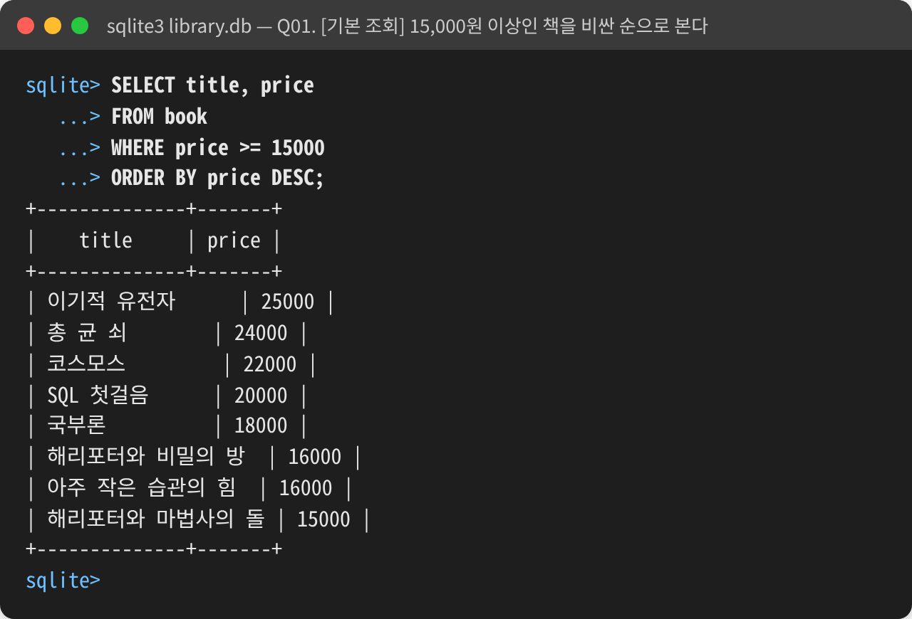

<a id="q02"></a>
## Q02. [기본 조회] 제목에 "해리포터"가 들어간 책을 찾는다

```sql
SELECT title, price
FROM book
WHERE title LIKE '%해리포터%';
```

|    title     | price |
|--------------|-------|
| 해리포터와 마법사의 돌 | 15000 |
| 해리포터와 비밀의 방  | 16000 |

→ 2줄

**실행 화면**

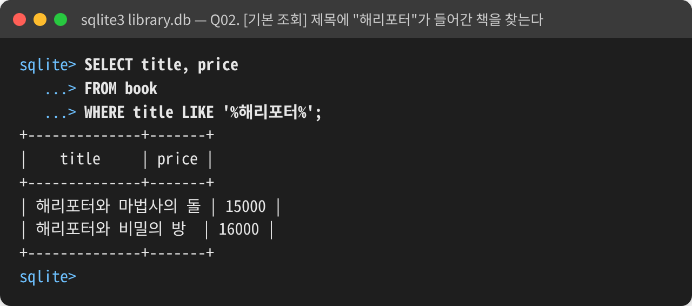

<a id="q03"></a>
## Q03. [기본 조회] 가장 비싼 책 TOP 3를 본다

```sql
SELECT title, price
FROM book
ORDER BY price DESC
LIMIT 3;
```

|  title  | price |
|---------|-------|
| 이기적 유전자 | 25000 |
| 총 균 쇠   | 24000 |
| 코스모스    | 22000 |

→ 3줄

**실행 화면**

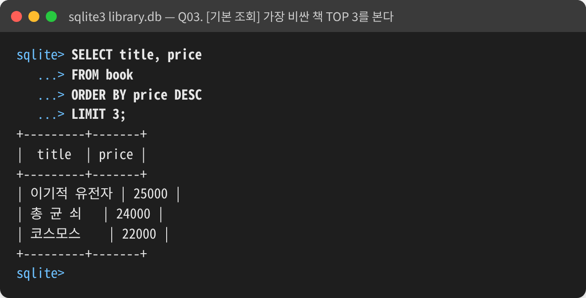

<a id="q04"></a>
## Q04. [기본 조회] 최근 30일(2026-09-14 ~ 2026-10-14) 대여 기록을 최신순으로 본다

```sql
SELECT id, member_id, book_id, rented_at
FROM rental
WHERE rented_at >= '2026-09-14'
ORDER BY rented_at DESC;
```

| id | member_id | book_id | rented_at  |
|----|-----------|---------|------------|
| 15 | 2         | 2       | 2026-10-12 |
| 14 | 6         | 4       | 2026-10-10 |
| 13 | 10        | 10      | 2026-10-07 |
| 12 | 1         | 1       | 2026-10-05 |
| 11 | 4         | 12      | 2026-10-01 |
| 10 | 8         | 8       | 2026-09-28 |
| 9  | 7         | 7       | 2026-09-25 |
| 8  | 2         | 5       | 2026-09-20 |
| 7  | 6         | 1       | 2026-09-18 |
| 6  | 1         | 3       | 2026-09-15 |

→ 10줄

**실행 화면**

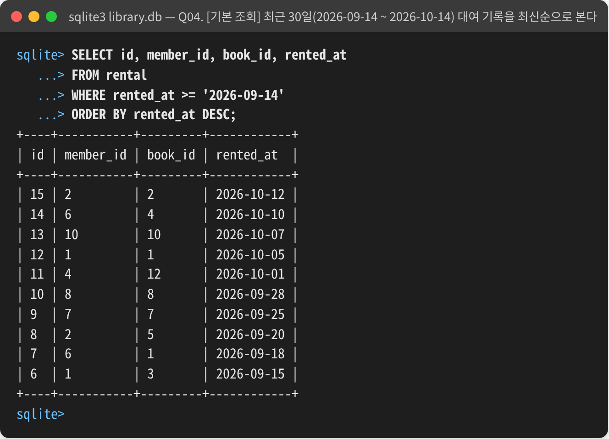

<a id="q05"></a>
## Q05. [INNER JOIN] 지금 대여 중인 책 목록 (반납 안 한 대여의 책 제목)

```sql
SELECT book.title, rental.rented_at
FROM rental
JOIN book ON rental.book_id = book.id
WHERE rental.returned_at IS NULL
ORDER BY rental.rented_at;
```

|    title     | rented_at  |
|--------------|------------|
| 해리포터와 마법사의 돌 | 2026-10-05 |
| 아주 작은 습관의 힘  | 2026-10-07 |
| 원피스 1권       | 2026-10-10 |
| 해리포터와 비밀의 방  | 2026-10-12 |

→ 4줄

**실행 화면**

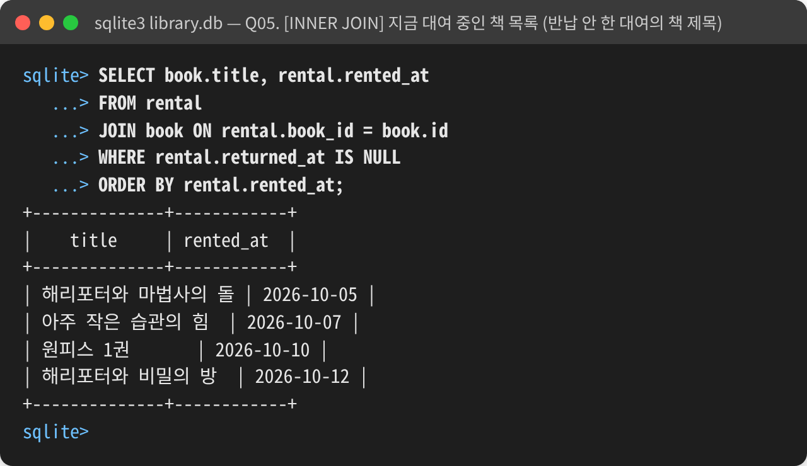

<a id="q06"></a>
## Q06. [INNER JOIN] 카테고리별 책을 본다 (책이 있는 카테고리만. Q08과 LEFT 한 단어만 다름)

```sql
SELECT category.name, book.title
FROM category
JOIN book ON book.category_id = category.id
ORDER BY category.id;
```

| name |    title     |
|------|--------------|
| 소설   | 해리포터와 마법사의 돌 |
| 소설   | 해리포터와 비밀의 방  |
| 소설   | 어린왕자         |
| 만화   | 원피스 1권       |
| 만화   | 슬램덩크 1권      |
| 과학   | 코스모스         |
| 과학   | 이기적 유전자      |
| 역사   | 총 균 쇠        |
| 경제   | 국부론          |
| 자기계발 | 아주 작은 습관의 힘  |
| 에세이  | 하루 한 줄 에세이   |
| IT   | SQL 첫걸음      |

→ 12줄

**실행 화면**

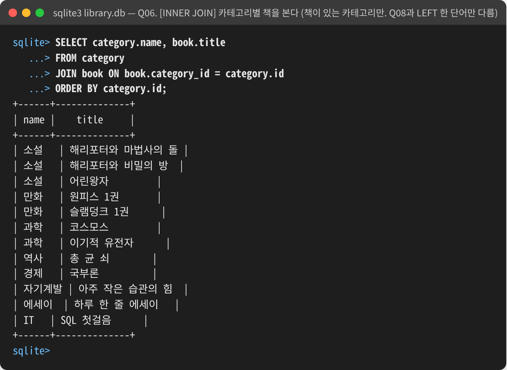

<a id="q07"></a>
## Q07. [LEFT JOIN] 대여 기록이 없는 회원도 포함해서 회원별 대여 번호를 본다

```sql
SELECT member.name, rental.id
FROM member
LEFT JOIN rental ON rental.member_id = member.id
ORDER BY member.id;
```

| name |  id  |
|------|------|
| 김철수  | 1    |
| 김철수  | 3    |
| 김철수  | 6    |
| 김철수  | 12   |
| 이영희  | 2    |
| 이영희  | 8    |
| 이영희  | 15   |
| 박민수  | NULL |
| 최지아  | 4    |
| 최지아  | 11   |
| 정하늘  | 5    |
| 강민준  | 7    |
| 강민준  | 14   |
| 윤서연  | 9    |
| 임도현  | 10   |
| 한서윤  | NULL |
| 오지훈  | 13   |

→ 17줄

**실행 화면**

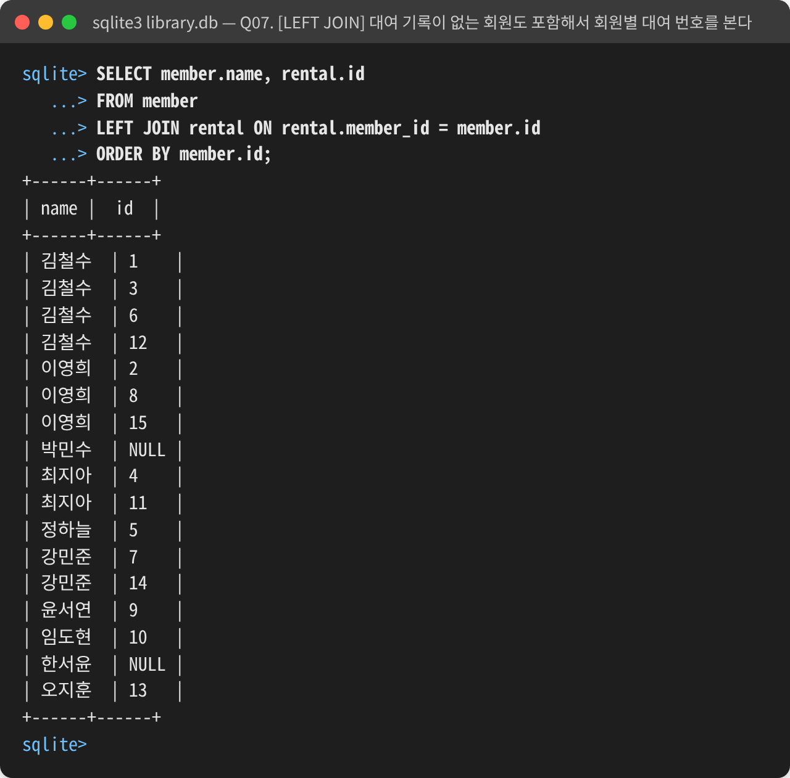

<a id="q08"></a>
## Q08. [LEFT JOIN] 책이 없는 카테고리도 포함해서 카테고리별 책을 본다 (Q06과 비교: 12줄 → 14줄)

```sql
SELECT category.name, book.title
FROM category
LEFT JOIN book ON book.category_id = category.id
ORDER BY category.id;
```

| name |    title     |
|------|--------------|
| 소설   | 어린왕자         |
| 소설   | 해리포터와 마법사의 돌 |
| 소설   | 해리포터와 비밀의 방  |
| 만화   | 슬램덩크 1권      |
| 만화   | 원피스 1권       |
| 과학   | 이기적 유전자      |
| 과학   | 코스모스         |
| 역사   | 총 균 쇠        |
| 경제   | 국부론          |
| 자기계발 | 아주 작은 습관의 힘  |
| 에세이  | 하루 한 줄 에세이   |
| IT   | SQL 첫걸음      |
| 시집   | NULL         |
| 요리   | NULL         |

→ 14줄

**실행 화면**

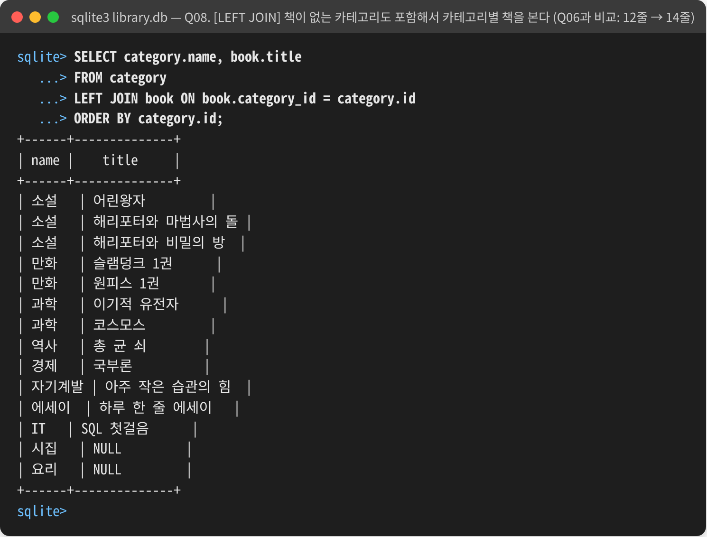

<a id="q09"></a>
## Q09. [집계] 회원별 대여 횟수를 많은 순으로 본다

```sql
SELECT member.name, COUNT(*)
FROM rental
JOIN member ON rental.member_id = member.id
GROUP BY member.name
ORDER BY COUNT(*) DESC;
```

| name | COUNT(*) |
|------|----------|
| 김철수  | 4        |
| 이영희  | 3        |
| 최지아  | 2        |
| 강민준  | 2        |
| 정하늘  | 1        |
| 임도현  | 1        |
| 윤서연  | 1        |
| 오지훈  | 1        |

→ 8줄

**실행 화면**

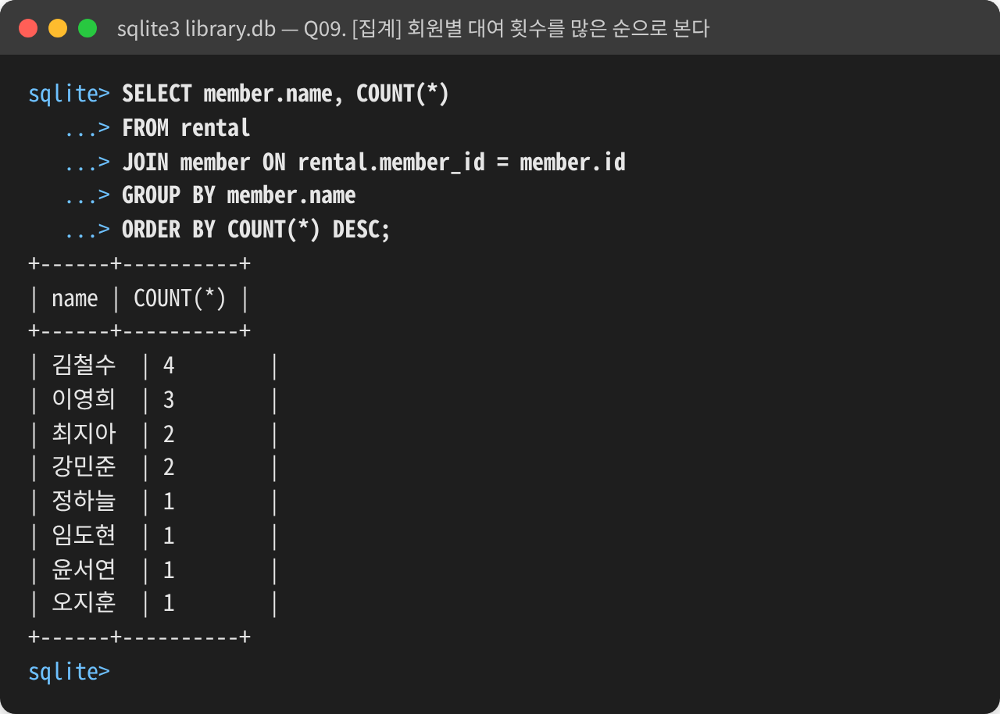

<a id="q10"></a>
## Q10. [집계] 카테고리별 책 수, 가격 합계, 평균 가격을 본다

```sql
SELECT category.name, COUNT(*), SUM(book.price), AVG(book.price)
FROM book
JOIN category ON book.category_id = category.id
GROUP BY category.name;
```

| name | COUNT(*) | SUM(book.price) | AVG(book.price)  |
|------|----------|-----------------|------------------|
| IT   | 1        | 20000           | 20000.0          |
| 경제   | 1        | 18000           | 18000.0          |
| 과학   | 2        | 47000           | 23500.0          |
| 만화   | 2        | 11000           | 5500.0           |
| 소설   | 3        | 40000           | 13333.3333333333 |
| 에세이  | 1        | 12000           | 12000.0          |
| 역사   | 1        | 24000           | 24000.0          |
| 자기계발 | 1        | 16000           | 16000.0          |

→ 8줄

**실행 화면**

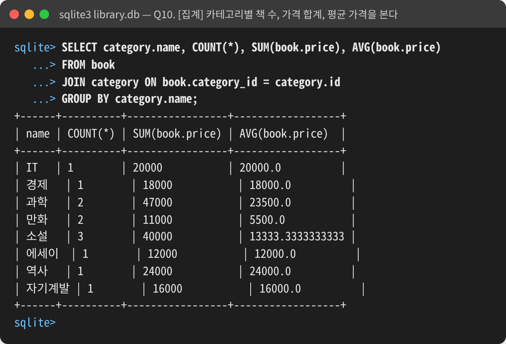

<a id="q11"></a>
## Q11. [집계] 가장 많이 대여된 책 TOP 3를 본다

```sql
SELECT book.title, COUNT(*)
FROM rental
JOIN book ON rental.book_id = book.id
GROUP BY book.title
ORDER BY COUNT(*) DESC
LIMIT 3;
```

|    title     | COUNT(*) |
|--------------|----------|
| 해리포터와 마법사의 돌 | 4        |
| 해리포터와 비밀의 방  | 2        |
| 원피스 1권       | 2        |

→ 3줄

**실행 화면**

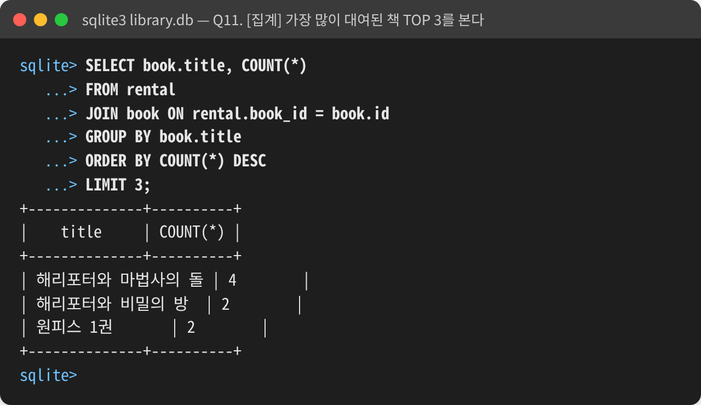

<a id="q12"></a>
## Q12. [서브쿼리] 대여 기록이 한 번도 없는 회원을 찾는다

```sql
SELECT name
FROM member
WHERE id NOT IN (SELECT member_id FROM rental);
```

| name |
|------|
| 박민수  |
| 한서윤  |

→ 2줄

**실행 화면**

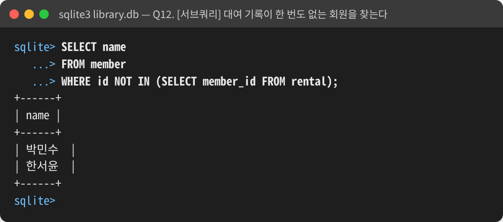

<a id="q13"></a>
## Q13. [UPDATE] 15번 대여를 오늘(2026-10-14) 반납 처리한다

```sql
UPDATE rental
SET returned_at = '2026-10-14'
WHERE id = 15;
```

출력 없음 (결과 표가 없는 문장. 아래 확인용 쿼리로 결과를 봅니다)

#### 확인 (15개에 세지 않음): 15번 대여의 반납일이 채워졌는지 본다

```sql
SELECT id, rented_at, returned_at
FROM rental
WHERE id = 15;
```

| id | rented_at  | returned_at |
|----|------------|-------------|
| 15 | 2026-10-12 | 2026-10-14  |

→ 1줄

**실행 화면**

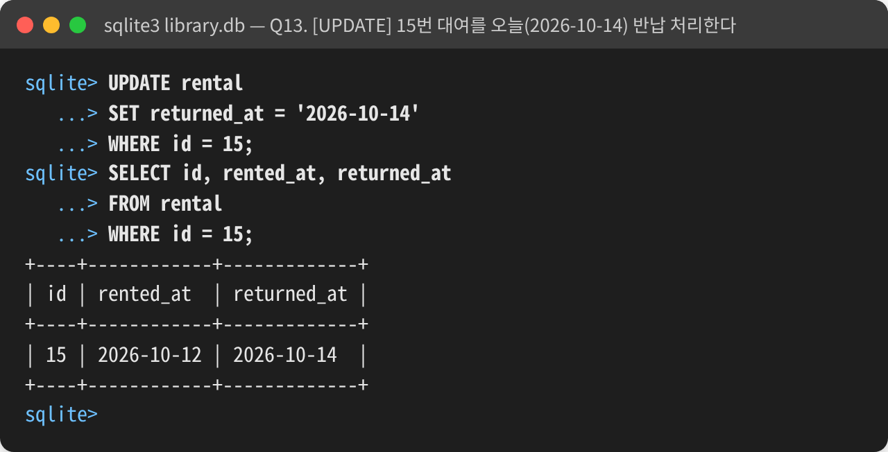

<a id="q14"></a>
## Q14. [DELETE] 대여 기록이 없는 회원 한서윤(9번)을 삭제한다 (가리키는 자식이 없어 FK에 막히지 않음)

```sql
DELETE FROM member
WHERE id = 9;
```

출력 없음 (결과 표가 없는 문장. 아래 확인용 쿼리로 결과를 봅니다)

#### 확인 (15개에 세지 않음): 회원이 9명이 됐는지 본다

```sql
SELECT id, name
FROM member;
```

| id | name |
|----|------|
| 1  | 김철수  |
| 2  | 이영희  |
| 3  | 박민수  |
| 4  | 최지아  |
| 5  | 정하늘  |
| 6  | 강민준  |
| 7  | 윤서연  |
| 8  | 임도현  |
| 10 | 오지훈  |

→ 9줄

**실행 화면**

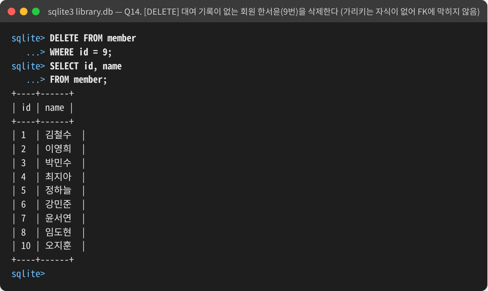

<a id="q15"></a>
## Q15. [인덱스] rental.member_id에 인덱스를 만든다

> 이유: Q07, Q12처럼 회원 번호로 대여 기록(rental)을 찾는 일이 많아서 member_id로 바로 찾게 하려고

```sql
CREATE INDEX idx_rental_member_id ON rental(member_id);
```

출력 없음 (결과 표가 없는 문장. 아래 확인용 쿼리로 결과를 봅니다)

#### 확인 (15개에 세지 않음, SQLite 전용): rental에 인덱스가 만들어졌는지 본다

```sql
PRAGMA index_list(rental);
```

| seq |         name         | unique | origin | partial |
|-----|----------------------|--------|--------|---------|
| 0   | idx_rental_member_id | 0      | c      | 0       |

→ 1줄

**실행 화면**

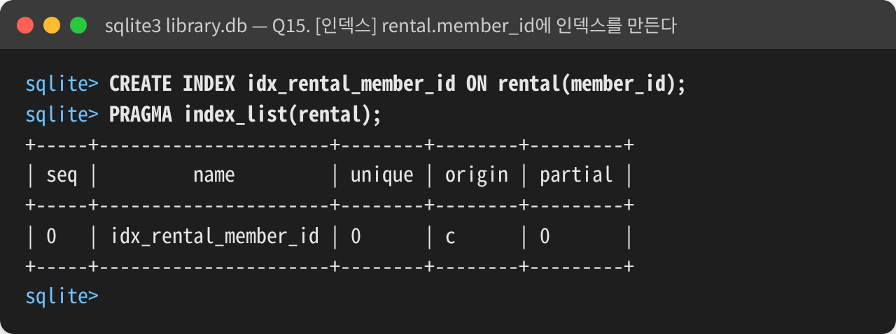
